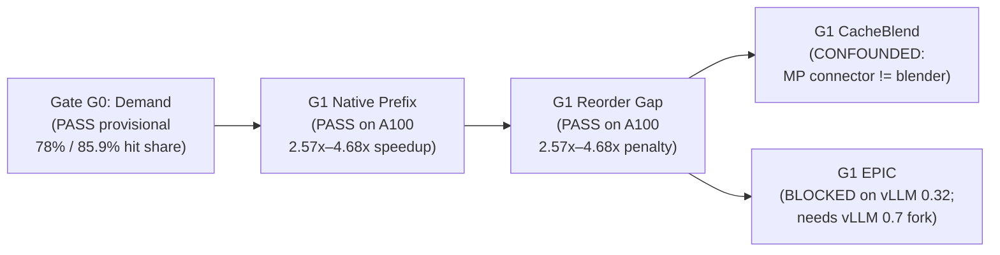

# ContextWeave — Deep Project Audit (Round 2: Post-G1 GPU Benchmarks)

**Date:** 2026-10-22  
**Scope:** Full audit of all changes since Initial Commit (`badd818` → `9816342`, 42 commits): Phase 0B / Gate G1 GPU benchmark suite (`scripts/g1_*`), `vllm_runners.py`, checked-in Colab A100 artifacts (`artifacts/g1-matched-2026-10-22/`), ResolventKV research integration (`Docs/Research/`), and core `src/contextweave/` library  
**Test Suite:** 84/84 passing (`pytest` 9.1.1, Python 3.14.4)

---

## Executive Summary

Since the previous review, the project has made a major leap from CPU-only simulation into **Phase 0B GPU empirical benchmarking** on an NVIDIA A100-SXM4-40GB (Colab), adding 16 new scripts/harnesses, 15 checked-in experimental JSON artifacts, `VllmEngineRunner` adapters, 26 new unit tests (40 → 84), and a disciplined scientific log that caught and voided two false-positive measurements (`1.22×` quality-corrupted MP blend and `1.32×` self-hit-polluted Gate E).

**However, a forensic audit of the new G1 harnesses and JSON artifacts reveals that the central experimental conclusions for CacheBlend ("Gate D PASS, Gate E FAIL — no non-prefix reuse on this pin") are confounded by 5 critical benchmark design bugs:**

1. **Gate D (`g1_matched_quality_bench.py`) never actually triggered CacheBlend blending** — it omitted the `" # # "` blend separator, passed raw strings instead of chunked prompts, and ran 12 questions against the *same* `bac` document order in a loop (turning cases 2–12 into exact prefix hits on case 1).
2. **Gate E (`g1_matched_ttft_bench.py`) never enabled blending in the client or aligned chunks to LMCache's 256-token blocks** — `LMCACHE_ENABLE_BLENDING` and `LMCACHE_BLEND_SPECIAL_STR` are never set in the MP scripts, `LMCacheMPConnector` is a passive ZMQ KV store (without the in-worker `LMCBlender` model-runner hook required for layer-1 filtering and RoPE delta rotation), and `chunk_tokens=3981` (`3981 % 256 = 141`) shifts every 256-token block boundary when chunks are reordered.
3. **Asymmetric execution & decode contamination in TTFT (`enforce_eager` + `max_tokens=16`)** — `native_prefix` ran with CUDA graphs (`enforce_eager=False`), while `blend` ran with `enforce_eager=True`, and `_ttft_ms` measures full `llm.generate()` wall-clock for 16 output tokens instead of streaming TTFT or `max_tokens=1`. That handicaps `blend` by **+332 ms (+28%)** even on a cold miss (`1507 ms` vs `1175 ms`).
4. **`g1_matched_blend.sh` crashes under `set -euo pipefail` at line 80** — running `--mode blend --order abc` without `--control-json` sets `gate_d_pass=False` and exits with code `4`.
5. **Unfixed `MAJ-2` in core library (`fingerprints_compatible`)** — `hash_build_context` still hashes `chunk_token_ids`, so `fingerprints_compatible()` still rejects any two distinct chunks with `build_context_hash_mismatch`.

| Severity | Count | Key Themes |
|---|---|---|
| 🔴 **Critical** | 5 | Invalidated Gate D/E CacheBlend measurements, broken shell pipeline, core fingerprint bug |
| 🟠 **Major** | 8 | L1 cache thrashing in salted TTFT, cold-nonce BOS corruption, scorer false-positives, PRD G1 gap |
| 🟡 **Minor** | 7 | Duplicate test class, `sys.path` / `importlib` hacks, residual `docs/` casing, stale overview table |

---

## 🔴 Critical Findings (5)

### CRIT-1 · Gate D Quality Benchmark (`g1_matched_quality_bench.py`) Never Triggered CacheBlend

**Files:** [`scripts/g1/matched/g1_matched_quality_bench.py`](file:///Users/apple/Code/Context%20Weave/scripts/g1/matched/g1_matched_quality_bench.py#L62-L86), [`scripts/g1/matched/g1_matched_blend.sh`](file:///Users/apple/Code/Context%20Weave/scripts/g1/matched/g1_matched_blend.sh#L79-L85), [`artifacts/g1-matched-2026-10-22/g1_matched_blend_bac.json`](file:///Users/apple/Code/Context%20Weave/artifacts/g1-matched-2026-10-22/g1_matched_blend_bac.json)

The experiment log concludes: *"Gate D PASS (`contains=1.0`, `garbage=0.0`, `agree_with_control=1.0`) — quality OK on this pin."*  
Inspecting [`g1_matched_quality_bench.py`](file:///Users/apple/Code/Context%20Weave/scripts/g1/matched/g1_matched_quality_bench.py#L62-L86) and the artifact latencies proves **CacheBlend was never active during Gate D**:

1. **No blend separator in prompts:** [`_doc_block()`](file:///Users/apple/Code/Context%20Weave/scripts/g1/matched/g1_matched_quality_bench.py#L62-L64) formats documents as markdown (`### DOC-A7\n...`) and joins them with `"\n"`. The CacheBlend delimiter (`" # # "`) is completely absent from `g1_matched_quality_bench.py`.
2. **All 12 cases in `g1_matched_blend_bac.json` share an identical `bac` prefix:** In [`main()`](file:///Users/apple/Code/Context%20Weave/scripts/g1/matched/g1_matched_quality_bench.py#L133-L135), all 12 prompts are built with the exact same `body` (`order="bac"`), differing only in the trailing `question`. Thus, Case 1 (`code_a7`) is a full-prefill miss on `bac`, and Cases 2–12 are **exact prefix hits on `bac`**, not blended reorders of `abc`.
3. **Artifact latencies confirm ~3.3s of decode dominates:** Every case in [`g1_matched_control.json`](file:///Users/apple/Code/Context%20Weave/artifacts/g1-matched-2026-10-22/g1_matched_control.json), [`g1_matched_blend_abc.json`](file:///Users/apple/Code/Context%20Weave/artifacts/g1-matched-2026-10-22/g1_matched_blend_abc.json), and [`g1_matched_blend_bac.json`](file:///Users/apple/Code/Context%20Weave/artifacts/g1-matched-2026-10-22/g1_matched_blend_bac.json) takes `3466–3917 ms` because Qwen3 generates 96 tokens of repetitive text (`"Kepler\n\nKepler\n\n..."`), except `id_d2` in `bac` (`289 ms`, which stopped after 4 tokens).

> [!CAUTION]
> Gate D passed only because `lmcache server` fell back to normal non-blended prefill/prefix behavior on unseparated markdown strings. It did not test whether CacheBlend's selective recompute preserves answer quality.

---

### CRIT-2 · Why Gate E (`chunk_sep`) Showed Zero Non-Prefix Reuse (`1503 ms ≈ 1507 ms` Cold)

**Files:** [`scripts/g1/matched/g1_matched_ttft_bench.py`](file:///Users/apple/Code/Context%20Weave/scripts/g1/matched/g1_matched_ttft_bench.py#L119-L139), [`scripts/g1/matched/g1_matched_ttft_chunk_e.sh`](file:///Users/apple/Code/Context%20Weave/scripts/g1/matched/g1_matched_ttft_chunk_e.sh#L36-L70), [`artifacts/g1-matched-2026-10-22/g1_ttft_blend_12k_chunks.json`](file:///Users/apple/Code/Context%20Weave/artifacts/g1-matched-2026-10-22/g1_ttft_blend_12k_chunks.json)

In [`g1_ttft_blend_12k_chunks.json`](file:///Users/apple/Code/Context%20Weave/artifacts/g1-matched-2026-10-22/g1_ttft_blend_12k_chunks.json), `warm_abc` drops from `1506.9 ms` (cold) to `776.1 ms` (proving `LMCacheMPConnector` prefix hits work), whereas `warm_bac` (`1506.3 ms`) and `warm_cba` (`1499.7 ms`) are 100% cold misses. Three reasons in the harness explain this:

1. **Architecture mismatch (`LMCacheMPConnector` vs in-worker `LMCBlender`):**  
   `LMCacheMPConnector` (vLLM V1 external ZMQ connector) transfers KV blocks between vLLM and `lmcache server`. However, vLLM stores KV **post-RoPE**. Reusing chunk `B` at token offset `19` when it was cached at token offset `4002` requires **in-model-runner layerwise intervention** (`LMCBlender`: RoPE delta rotation + layer-1 attention filtering + 15% token recompute). A passive out-of-process ZMQ KV store (`lmcache server`) cannot mutate vLLM's internal attention forward pass unless the client worker activates `LMCBlender`.
2. **Missing blend environment variables on the client:**  
   Unlike [`g1_cacheblend_bench.py`](file:///Users/apple/Code/Context%20Weave/scripts/g1/cacheblend/g1_cacheblend_bench.py#L42-L50) (which exports `LMCACHE_ENABLE_BLENDING=True`, `LMCACHE_BLEND_SPECIAL_STR=" # # "`, `LMCACHE_USE_LAYERWISE=True`), neither [`g1_matched_ttft_bench.py`](file:///Users/apple/Code/Context%20Weave/scripts/g1/matched/g1_matched_ttft_bench.py#L395-L411) nor [`g1_matched_ttft_chunk_e.sh`](file:///Users/apple/Code/Context%20Weave/scripts/g1/matched/g1_matched_ttft_chunk_e.sh) sets `LMCACHE_ENABLE_BLENDING` or `LMCACHE_BLEND_SPECIAL_STR` for the vLLM worker process.
3. **256-token block misalignment (`chunk_tokens = 3981`):**  
   Even for block-level lookup in `LMCacheMPConnector` (`--chunk-size 256`), [`_chunk_tokens_for_target()`](file:///Users/apple/Code/Context%20Weave/scripts/g1/matched/g1_matched_ttft_bench.py#L119-L139) computes `usable // 3 = 3981` (`3981 % 256 = 141`), and `len(system) + len(sep)` is not a multiple of 256. When flat `prompt_token_ids` are sliced into 256-token pages from index 0, moving chunk `B` before chunk `A` shifts every 256-token boundary by `(3981 + len(sep)) % 256` tokens, guaranteeing 0% block-hash overlap.

---

### CRIT-3 · TTFT Benchmark Measures 16-Token Decode + Asymmetric `enforce_eager` (+332 ms Handicap)

**Files:** [`scripts/g1/matched/g1_matched_ttft_bench.py`](file:///Users/apple/Code/Context%20Weave/scripts/g1/matched/g1_matched_ttft_bench.py#L164-L175), [`scripts/g1/matched/g1_matched_ttft_bench.py`](file:///Users/apple/Code/Context%20Weave/scripts/g1/matched/g1_matched_ttft_bench.py#L391-L403), [`src/contextweave/runtime_adapters/vllm_runners.py`](file:///Users/apple/Code/Context%20Weave/src/contextweave/runtime_adapters/vllm_runners.py#L61-L70)

Despite the runbook requirement ([`claude_g1_cacheblend_matched_image_runbook.md#L78`](file:///Users/apple/Code/Context%20Weave/Docs/Reviews/claude_g1_cacheblend_matched_image_runbook.md#L78): *"Measure TTFT with streaming (time to first token), not total latency"*), every benchmark script calls synchronous `llm.generate()` with `max_tokens=16` (or `24`/`32`) and records total wall-clock time:

- In [`g1_matched_ttft_bench.py#L392-L402`](file:///Users/apple/Code/Context%20Weave/scripts/g1/matched/g1_matched_ttft_bench.py#L392-L402), `--backend native_prefix` ignores `--enforce-eager` and runs with **CUDA graphs enabled (`enforce_eager=False`)**, whereas `--backend blend` runs with **`enforce_eager=True`**.
- Comparing cold 12k-token runs in [`g1_ttft_native_12k_chunks.json`](file:///Users/apple/Code/Context%20Weave/artifacts/g1-matched-2026-10-22/g1_ttft_native_12k_chunks.json) (`1174.7 ms`) vs [`g1_ttft_blend_12k_chunks.json`](file:///Users/apple/Code/Context%20Weave/artifacts/g1-matched-2026-10-22/g1_ttft_blend_12k_chunks.json) (`1506.9 ms`), `blend` is **332 ms (+28.3%) slower on identical cold work** purely from `enforce_eager=True` + 16 eager decode steps + ZMQ store overhead.
- **Fix:** Set `--max-tokens 1` (or read `outs[0].metrics.first_token_time - outs[0].metrics.arrival_time` when available) for all TTFT benchmarks, and enforce identical `enforce_eager` settings across both backends when comparing latency in Gate E.

---

### CRIT-4 · `g1_matched_blend.sh` Fails with Exit Code 4 on Line 80 Under `set -euo pipefail`

**Files:** [`scripts/g1/matched/g1_matched_blend.sh#L80-L85`](file:///Users/apple/Code/Context%20Weave/scripts/g1/matched/g1_matched_blend.sh#L80-L85), [`scripts/g1/matched/g1_matched_quality_bench.py#L212-L249`](file:///Users/apple/Code/Context%20Weave/scripts/g1/matched/g1_matched_quality_bench.py#L212-L249)

In [`g1_matched_blend.sh#L80-L81`](file:///Users/apple/Code/Context%20Weave/scripts/g1/matched/g1_matched_blend.sh#L80-L81):
```bash
python scripts/g1/matched/g1_matched_quality_bench.py --mode blend --order abc \
  --out g1_matched_blend_abc.json
```
Because `--control-json` is omitted on this first `blend` call, `agree_rate` is `None` in [`g1_matched_quality_bench.py#L209-L217`](file:///Users/apple/Code/Context%20Weave/scripts/g1/matched/g1_matched_quality_bench.py#L209-L217), causing `gate_d = False`, `pass_heuristic = False`, and `sys.exit(4)` (confirmed in [`artifacts/g1-matched-2026-10-22/g1_matched_blend_abc.json#L163-L164`](file:///Users/apple/Code/Context%20Weave/artifacts/g1-matched-2026-10-22/g1_matched_blend_abc.json#L163-L164): `"gate_d_pass": false, "pass_heuristic": false`). Because `g1_matched_blend.sh` sets `set -euo pipefail`, the script aborts at line 80 before ever running the `bac` reorder check on line 82.

**Fix:** Pass `--control-json g1_matched_control.json` on line 80 of `g1_matched_blend.sh` (or allow `--mode blend` without `--control-json` to use `gate_c` bars when seeding).

---

### CRIT-5 · `fingerprints_compatible()` Still Rejects Cross-Chunk Reuse (Carried Over from Round 1 `MAJ-2`)

**Files:** [`src/contextweave/fingerprints/schema.py#L285-L300`](file:///Users/apple/Code/Context%20Weave/src/contextweave/fingerprints/schema.py#L285-L300), [`src/contextweave/fingerprints/validate.py#L118-L127`](file:///Users/apple/Code/Context%20Weave/src/contextweave/fingerprints/validate.py#L118-L127)

This issue from Round 1 was not fixed: [`hash_build_context()`](file:///Users/apple/Code/Context%20Weave/src/contextweave/fingerprints/schema.py#L285-L300) includes `"chunk": chunk_token_ids` in `build_context_hash`, and [`fingerprints_compatible()`](file:///Users/apple/Code/Context%20Weave/src/contextweave/fingerprints/validate.py#L118-L127) rejects any artifact where `artifact.build_context.build_context_hash != request.build_context.build_context_hash`. Because two different document chunks have different `chunk_token_ids`, `fingerprints_compatible()` rejects all cross-chunk reuse with `"build_context_hash_mismatch"`, contradicting its own docstring (*"Content identity may differ (that's the point of reuse); model/rope/tokenizer/build policy must match"*).

**Fix:** Remove `"chunk": chunk_token_ids` from `hash_build_context()` (chunk tokens already live in `ContentIdentity.token_ids_sha256`), or compare build-context policy fields (`prefix`, `sink_prefix_token_count`, `adapter`, `mask`) in `fingerprints_compatible()`.

---

## 🟠 Major Findings (8)

### MAJ-1 · Salted TTFT Loop Pushes ~31 GB of KV into an 8 GB LMCache L1 Server

**Files:** [`scripts/g1/matched/g1_matched_ttft_bench.py#L360-L383`](file:///Users/apple/Code/Context%20Weave/scripts/g1/matched/g1_matched_ttft_bench.py#L360-L383), [`scripts/g1/matched/g1_matched_ttft_chunk_e.sh#L42`](file:///Users/apple/Code/Context%20Weave/scripts/g1/matched/g1_matched_ttft_chunk_e.sh#L42)

In [`g1_matched_ttft_bench.py`](file:///Users/apple/Code/Context%20Weave/scripts/g1/matched/g1_matched_ttft_bench.py#L360-L383), each of the 10 `warm_bac` and 10 `warm_cba` trials generates uniquely salted 12k-token prompts (`abc_i` + `reorder_i`). For Qwen3-8B (`128 KiB/token`), each 12k prompt is **~1.57 GB of KV**. Across 1 seed + 10 `bac` pairs + 10 `cba` pairs + 10 `cold` runs, the benchmark streams **>30 GB of unique KV blocks** into an `lmcache server` started with `--l1-size-gb 8` ([`g1_matched_ttft_chunk_e.sh#L42`](file:///Users/apple/Code/Context%20Weave/scripts/g1/matched/g1_matched_ttft_chunk_e.sh#L42)), causing continuous LRU eviction churn during measurement.
- Additionally, look at [`g1_ttft_blend_12k_chunks.json#L21-L23`](file:///Users/apple/Code/Context%20Weave/artifacts/g1-matched-2026-10-22/g1_ttft_blend_12k_chunks.json#L21-L23): in `warm_abc`, Trial 1 (immediately after `[seed abc]`) took **`1063.0 ms`**, while Trials 2–10 took **`764–785 ms`**. Seeding `abc_i` once and immediately querying `reorder_i` in `_measure_reorder_after_abc` does not even give `abc_i` the 2nd-access warm state seen in `warm_abc`.

---

### MAJ-2 · Cold Nonce Prepending Duplicates BOS Token & Leaks into Model Output

**Files:** [`scripts/g1/matched/g1_matched_ttft_bench.py#L318`](file:///Users/apple/Code/Context%20Weave/scripts/g1/matched/g1_matched_ttft_bench.py#L318), [`scripts/g1/matched/g1_matched_ttft_bench.py#L469-L477`](file:///Users/apple/Code/Context%20Weave/scripts/g1/matched/g1_matched_ttft_bench.py#L469-L477), [`artifacts/g1-matched-2026-10-22/g1_ttft_native_12k_chunks.json#L91`](file:///Users/apple/Code/Context%20Weave/artifacts/g1-matched-2026-10-22/g1_ttft_native_12k_chunks.json#L91)

`prompts["abc"]` begins with `system = tokenizer.encode(SYSTEM_TEXT, add_special_tokens=True)` (which starts with `bos_token_id`). In the `cold_abc` loop:
```python
nonce = tokenizer.encode(f"[cold-nonce-{i}-{time.time_ns()}]", add_special_tokens=False)
cold_ids = nonce + prompts["abc"]
```
Prepending `nonce` before `prompts["abc"]` places raw tokens *before* the BOS token (`<|im_start|>` / BOS), changes total prompt length vs `warm_abc`, and causes the model to echo `"Karachi\n[cold-nonce-9-17926"` in the artifacts. Moreover, on line 475, if `len(cold_ids) + args.max_tokens > args.max_model_len`, it slices `nonce[:16] + prompts["abc"]` — which **still** exceeds `max_model_len` if `prompts["abc"]` was already near `max_model_len - max_tokens`!

**Fix:** Insert the nonce *inside* `system` (after the BOS token) and subtract `len(nonce)` from the chunk filler budget so `len(cold_ids) == len(prompts["abc"])`.

---

### MAJ-3 · `g1_epic_bench.py` Times KV Collection + Cloning Inside the Benchmark Loop (`_collect_and_link`)

**File:** [`scripts/g1/epic/g1_epic_bench.py#L54-L125`](file:///Users/apple/Code/Context%20Weave/scripts/g1/epic/g1_epic_bench.py#L54-L125)

In [`_collect_and_link()`](file:///Users/apple/Code/Context%20Weave/scripts/g1/epic/g1_epic_bench.py#L54-L125):
1. Only `n=1` run is performed (no warmup, no p50/CV over $\ge 5$ runs as required by Gate G1).
2. Line 71 encodes each doc with `add_special_tokens=True` (`[tokenizer.encode(d, add_special_tokens=True) for d in docs]`), injecting a BOS token at the start of **every document chunk** in `input_ids`, whereas `_full_prefill` encodes the concatenated string with a single BOS token.
3. Line 107 (`if i == len(start_offset) - 2:`) assumes the last element of `token_ids` is the question tail, which works for 5 segments (`[system, docB, docC, docA, q]`), but if `recomp_num` exceeds a chunk's length (`start_offset[i] + recomp_num > start_offset[i+1]`), `meta["kvlink"]` produces duplicate/overlapping token indices.

---

### MAJ-4 · Scorer Substring & `<thinking>` Tag Vulnerabilities in `g1_scoring.py`

**Files:** [`scripts/g1/common/g1_scoring.py#L8-L30`](file:///Users/apple/Code/Context%20Weave/scripts/g1/common/g1_scoring.py#L8-L30), [`artifacts/g1-matched-2026-10-22/g1_matched_control.json#L100`](file:///Users/apple/Code/Context%20Weave/artifacts/g1-matched-2026-10-22/g1_matched_control.json#L100)

1. **Unclosed `<think>` / `<thinking>` tags:** Look at [`g1_matched_control.json#L100`](file:///Users/apple/Code/Context%20Weave/artifacts/g1-matched-2026-10-22/g1_matched_control.json#L100): Qwen3 emitted `<thinking>\nOkay, let me try to figure this out...` (using `<thinking>`, not `<think>`, and truncated by `max_tokens=96` before any closing tag!). `_THINK_RE = re.compile(r"<think>[\s\S]*?</think>", re.IGNORECASE)` misses both `<thinking>` and unclosed `<think>` blocks truncated by `max_tokens`.
2. **Substring match without word boundaries:** `gold.lower() in cleaned.lower()` (line 25 & 80) matches `"2019"` inside `"20190"` or `"ID-2019-X"`, and in `extract_answer(cleaned, gold=gold)`, if the model echoes all documents or says `"It is NOT Karachi, it is Lahore"`, `extract_answer` returns `"Karachi"` and marks `exact=True, contains=True, agrees_with_control=True`!

---

### MAJ-5 · PRD Gate G1 Requirements vs Current G1 Evidence

**Files:** [`Docs/prd/contextweave_prd_v2.md`](file:///Users/apple/Code/Context%20Weave/Docs/prd/contextweave_prd_v2.md), [`Docs/prd/contextweave_prd_v2.1_amendments.md`](file:///Users/apple/Code/Context%20Weave/Docs/prd/contextweave_prd_v2.1_amendments.md), [`Docs/core/assumptions.md`](file:///Users/apple/Code/Context%20Weave/Docs/core/assumptions.md)

Checking the formal PRD G1 gate criteria against what has been run:
- **Primary model (`Llama-3.1-8B-Instruct` with `llama3` scaled RoPE):** Not run yet (only `Qwen/Qwen3-8B` has been tested on GPU).
- **CV of p50 TTFT $\le 10\%$ over $\ge 5$ runs:** The early G1 step 1 (`g1_ttft_bench.py`) and step 2b (`g1_reorder_gap_bench.py`) used $n=3$ and $n=1$ respectively (and their JSON files were not checked into `artifacts/`). The later `g1_matched_ttft_bench.py` runs use $n=10$ with very tight variance (e.g., native 12k warm_abc p50 `250.5 ms`, p90 `250.6 ms`), but none of the scripts compute or report the **Coefficient of Variation (CV)** required by the PRD.
- **Multi-hop receiver-necessary evaluation:** [`Docs/Research/ResolventKV-adoption.md#L25`](file:///Users/apple/Code/Context%20Weave/Docs/Research/ResolventKV-adoption.md#L25) and [`Docs/core/assumptions.md#L24`](file:///Users/apple/Code/Context%20Weave/Docs/core/assumptions.md#L24) specify **multi-hop** answer preservation (where answering requires combining facts across $\ge 2$ reordered chunks). Both `g1_quality_bench.py` and `g1_matched_quality_bench.py` are **single-hop** needle-in-a-haystack lookups (`"What is the secret code in DOC-A7?"`), which do not test cross-chunk causal closure.

---

### MAJ-6 · `g1_matched_install.sh` Did Not Actually Downgrade vLLM to Match `lmcache==0.5.3`

**Files:** [`scripts/g1/matched/g1_matched_install.sh#L22-L28`](file:///Users/apple/Code/Context%20Weave/scripts/g1/matched/g1_matched_install.sh#L22-L28), [`artifacts/g1-matched-2026-10-22/g1_matched_env.json`](file:///Users/apple/Code/Context%20Weave/artifacts/g1-matched-2026-10-22/g1_matched_env.json)

The goal of `g1_matched_install.sh` was to avoid the `vLLM 0.32.0` + `lmcache` mismatch by matching the `lmcache/vllm-openai:v0.5.3` era. However, because `VLLM_PIN` defaults to `""`:
```bash
pip install "lmcache==${LMCACHE_PIN}"
python -c "import vllm" 2>/dev/null || pip install "vllm"
```
`pip install lmcache==0.5.3` left the pre-installed `vllm==0.32.0` and `torch==2.13.0+cu130` untouched! As recorded in [`g1_matched_env.json`](file:///Users/apple/Code/Context%20Weave/artifacts/g1-matched-2026-10-22/g1_matched_env.json), the "matched" session still ran on **`vllm 0.32.0` + `lmcache 0.5.3`** — widening the version gap (`0.32.0` vs `0.5.3`) rather than using the `vLLM` version bundled with `lmcache 0.5.3`.

---

### MAJ-7 · `g1_matched_smoke.sh` Re-Introduces Unquoted Here-Doc Interpolation (`CRIT-4` Regression)

**File:** [`scripts/g1/matched/g1_matched_smoke.sh#L15-L28`](file:///Users/apple/Code/Context%20Weave/scripts/g1/matched/g1_matched_smoke.sh#L15-L28)

While `scripts/smoke/smoke_remote.sh` was hardened in Round 1 to use a quoted `<<'PY'` here-doc and `os.environ`, the newly created [`scripts/g1/matched/g1_matched_smoke.sh`](file:///Users/apple/Code/Context%20Weave/scripts/g1/matched/g1_matched_smoke.sh#L15-L28) uses an unquoted `<<PY` with `"${MODEL}"` interpolated directly into Python source (`model = os.environ.get("SMOKE_MODEL", "${MODEL}")`), and passes if `"ok" in text.lower()` (which matches almost any English sentence containing the letters `"ok"`, such as `"token"` or `"book"`!).

---

### MAJ-8 · `g1_collect_artifacts.sh` Misses Half of the Generated Artifact Files

**File:** [`scripts/g1/matched/g1_collect_artifacts.sh#L8-L16`](file:///Users/apple/Code/Context%20Weave/scripts/g1/matched/g1_collect_artifacts.sh#L8-L16)

`FILES=(...)` hardcodes only 7 filenames (`g1_matched_ttft_native.json`, etc.) and misses all the newer files produced by `g1_matched_ttft_chunk_e.sh` and the 6k/12k runs (`g1_ttft_native_fixed.json`, `g1_ttft_blend_fixed.json`, `g1_ttft_native_12k.json`, `g1_ttft_blend_12k_salted.json`, `g1_ttft_native_12k_chunks.json`, `g1_ttft_blend_12k_chunks.json`).

---

## 🟡 Minor Findings & Hygiene (7)

| ID | Location | Finding |
|---|---|---|
| **MIN-1** | [`tests/unit/test_g1_benches.py#L26`](file:///Users/apple/Code/Context%20Weave/tests/unit/test_g1_benches.py#L26), [`#L204`](file:///Users/apple/Code/Context%20Weave/tests/unit/test_g1_benches.py#L204) | `class _FakeTok:` is defined **twice** in the same file (line 26 and line 204), with the second definition shadowing the first. |
| **MIN-2** | [`scripts/g1_*.py`](file:///Users/apple/Code/Context%20Weave/scripts/g1/matched/g1_matched_ttft_bench.py#L34-L35), [`tests/unit/test_g1_*.py`](file:///Users/apple/Code/Context%20Weave/tests/unit/test_g1_benches.py#L17-L23) | 9 scripts live in `scripts/` as standalone ~200–550 LOC programs instead of under `src/contextweave/`, forcing `sys.path.insert` and `importlib.util.spec_from_file_location` hacks across scripts and tests. |
| **MIN-3** | [`Docs/core/project-overview.md#L173-L185`](file:///Users/apple/Code/Context%20Weave/Docs/core/project-overview.md#L173-L185), [`Docs/core/assumptions.md#L16`](file:///Users/apple/Code/Context%20Weave/Docs/core/assumptions.md#L16) | Stale statements: `assumptions.md` still says `"GPU: None yet — rent only after G0 note + reproduction runbooks exist"`, and `project-overview.md` omits the G1 GPU harnesses and Colab A100 experimental artifacts that now exist in the repo. |
| **MIN-4** | [`Docs/status/experiment-log.md#L179-L255`](file:///Users/apple/Code/Context%20Weave/Docs/status/experiment-log.md#L179-L255) | Chronological order inversion: `2026-10-22` entries (lines 179–236) appear *before* the `2026-10-21 — G1 Colab pin closeout` entry (line 237), followed by more `2026-10-22` entries (lines 258–308). |
| **MIN-5** | [`src/contextweave/safety.py#L43`](file:///Users/apple/Code/Context%20Weave/src/contextweave/safety.py#L43), [`base.py#L72`](file:///Users/apple/Code/Context%20Weave/src/contextweave/runtime_adapters/base.py#L72), [`registry.py#L47`](file:///Users/apple/Code/Context%20Weave/src/contextweave/runtime_adapters/registry.py#L47), [`run_baseline.py#L22`](file:///Users/apple/Code/Context%20Weave/scripts/workloads/run_baseline.py#L22) | 5 error strings in Python source still reference lowercase `docs/...` instead of `Docs/...`. |
| **MIN-6** | [`README.md#L43-L74`](file:///Users/apple/Code/Context%20Weave/README.md#L43-L74) | `README.md` Docs table is missing links to the new G1 docs and artifacts: [`Docs/gates/g1/g1-epic.md`](file:///Users/apple/Code/Context%20Weave/Docs/gates/g1/g1-epic.md), [`Docs/gates/g1/g1-matched-colab.md`](file:///Users/apple/Code/Context%20Weave/Docs/gates/g1/g1-matched-colab.md), [`Docs/Reviews/claude_g1_cacheblend_matched_image_runbook.md`](file:///Users/apple/Code/Context%20Weave/Docs/Reviews/claude_g1_cacheblend_matched_image_runbook.md), and [`artifacts/g1-matched-2026-10-22/README.md`](file:///Users/apple/Code/Context%20Weave/artifacts/g1-matched-2026-10-22/README.md). |
| **MIN-7** | [`src/contextweave/`](file:///Users/apple/Code/Context%20Weave/src/contextweave/) | 7 empty stub subpackages (`api`, `artifacts`, `compatibility`, `planner`, `repair`, `rope`, `telemetry`) and `.tmp/` local directory remain from Phase 0 scaffolding. |

---

## Strategic & Scientific Assessment: Where Does ContextWeave Stand?



1. **What you have genuinely proven on GPU:**
   - **Native prefix caching works and is fast** (`250 ms` warm ABC vs `1175 ms` cold at 12k tokens = **4.68× speedup**).
   - **The non-prefix reorder penalty is huge and real** (`1173 ms` warm reorder vs `250 ms` warm ABC = **4.68× slowdown** at 12k tokens with $n=10$ and clean cache resets). This strongly validates the *problem* ContextWeave targets.
2. **What is NOT yet proven (and why):**
   - Your negative Gate E results (`blend reorder ≈ cold`) do **not** show that CacheBlend's algorithm fails at 6k/12k tokens. They show that **`LMCacheMPConnector` against an external `lmcache server` without `LMCBlender` model-runner hooks and without 256-token-aligned chunks does not perform non-prefix blending at all**.
   - Similarly, Gate D did not test blended KV quality because the prompts had no `" # # "` separators and repeated the same `bac` prefix 12 times.

---

## Priority Remediation Plan

1. **Fix Core & Script Blockers (CPU, immediate):**
   - Fix `CRIT-5` (`hash_build_context` / `fingerprints_compatible`) so cross-chunk reuse validation works.
   - Fix `CRIT-4` (`g1_matched_blend.sh` line 80 `--control-json`) so the shell pipeline doesn't exit 4.
   - Fix `CRIT-3` in `g1_matched_ttft_bench.py` and `vllm_runners.py`: default `--max-tokens 1` for TTFT measurement, match `enforce_eager` between arms, and report CV ($\sigma / \mu$).
   - Fix `MAJ-2` (move cold nonce after BOS token and keep prompt length constant) and `MAJ-4` (handle `<thinking>` / unclosed think tags and word boundaries in `g1_scoring.py`).
   - Fix `MIN-1` (duplicate `_FakeTok`), `MIN-5` (`Docs/` casing in Python strings), and `MAJ-7`/`MAJ-8` (`g1_matched_smoke.sh`, `g1_collect_artifacts.sh`).
2. **Fix CacheBlend Benchmark Protocol Before Any Future GPU Run:**
   - In `g1_matched_quality_bench.py` (`CRIT-1`): format documents with `" # # "` separators (`prompt_token_ids`), seed each document chunk **independently** (or in `abc` order) before querying a **single** reordered `bac` prompt per case (or reset between cases so Case 2..12 aren't prefix hits on Case 1), and include multi-hop questions requiring facts from $\ge 2$ documents.
   - In `g1_matched_ttft_bench.py` (`CRIT-2`, `MAJ-1`): export `LMCACHE_ENABLE_BLENDING=True` and `LMCACHE_BLEND_SPECIAL_STR=" # # "`, align chunk lengths to multiples of `256` tokens, and use an actual matched `vLLM` + `lmcache` version pair (`g1_matched_install.sh` must pin `VLLM_PIN`, not leave `vllm 0.32.0` installed).
