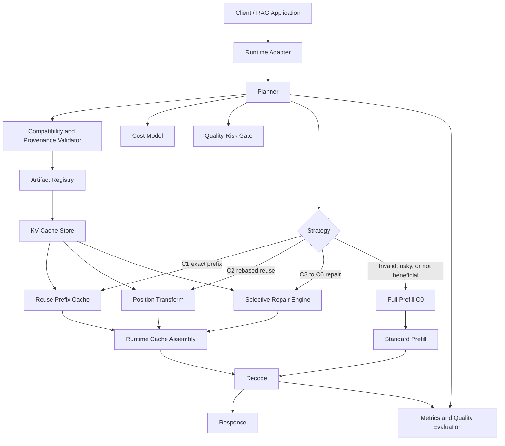

# Product Requirements Document (PRD)

## Modular KV-Cache Composition and Context Repair for LLM Inference

**Working title:** ContextWeave
**Former research concept:** Modular Prefill via Algebraic RoPE Rebasing (MP-ARR)
**Document type:** Research charter (Part I) and deferred product requirements (Part II)
**Status:** Draft. Approval requested for Phase 0 only (Section 0.5)
**Version:** 2.0 (supersedes v1.0; changes summarized in Appendix D)
**Date:** 11 October 2026
**Audience:** Founders, research engineers, inference engineers, systems engineers, technical advisors, potential design partners

**v2.1 amendments (14 Oct 2026):** Binding corrections from external review are in  
[`contextweave_prd_v2.1_amendments.md`](contextweave_prd_v2.1_amendments.md).  
Where that file conflicts with this document, **v2.1 amendments win**.

**How to read this document.** Part I (Sections 1 to 11) is the plan the team is being asked to approve and execute. Part II (Sections 12 to 21) holds the product requirements for a service that should only be built if the Part I gates are passed. Nothing in Part II is in scope today.

---

## 0. Executive Summary

### 0.1 Epistemic status

Every statement about ContextWeave's benefits is a hypothesis until measured. ContextWeave is not claimed as an invention: position-independent KV-cache reuse and selective repair are established and actively published areas (Section 4). Numeric thresholds marked **proposed** are defaults for the decision owner to ratify and timestamp before any Phase 1 result is viewed. This is the only place the document makes this disclaimer; later sections state only the specific caveats that matter.

### 0.2 Product in one sentence

ContextWeave is a validity-checked, quality-gated planner for self-hosted LLM serving. For each request containing recurring long-context chunks, it chooses among native prefix reuse, an existing non-prefix reuse or repair method, and full prefill, using measured cost and measured quality risk, and it refuses reuse whenever validity cannot be established.

### 0.3 The problem

LLM applications repeatedly process the same long content: code repositories, documentation, contracts, policy manuals, customer histories, schemas, and retrieval-augmented generation (RAG) passages. Reprocessing it on every request raises time-to-first-token (TTFT) and GPU cost.

Prefix caching reuses work only when a request shares a compatible prefix. When recurring documents appear in different positions or orders, prefix caching misses them. Position-independent caching (PIC) addresses that by caching chunks independently, but independently computed chunks lack cross-chunk attention, carry their own attention-sink artifacts, and depend on the context in which they were built. Published methods recover part of the lost quality by selective recomputation, attention reshaping, or training. An independent 2026 comparison found that existing approaches each have limits and are complementary rather than ordered (Section 4).

### 0.4 What this project will and will not do

**Will:** test whether a per-request planner that selects among existing methods, with validity checks and safe fallback, beats the best single fixed configuration on a real recurring-context workload at equal quality (Section 3).

**Will not (initially):** invent a new repair algorithm, train models, build a distributed cache, or claim exact equivalence to full-context prefill.

### 0.5 Decision requested

| Item | Request |
|---|---|
| Approve now | Phase 0A (demand and workload analysis) and Phase 0B (prior-art audit and baseline reproduction) |
| Time-box | 4 calendar weeks, then Gates G0 and G1 (Section 5) |
| Pre-authorized, contingent | Phase 1 starts automatically only if G0 and G1 both pass |
| Not approved | Phase 2 onward, any production infrastructure, any external claims |
| Effort (planning assumption) | About 8 person-weeks: research/inference engineer ~4, systems engineer ~3, evaluation support ~1 |
| Compute (planning assumption) | One 80 GB-class GPU, roughly 200 GPU-hours for Phase 0; multiply by the quoted hourly rate for the budget |
| Budget | **[USD amount: to be filled by the decision owner after GPU quotes]** |
| Decision owner | **[Name / role: to be assigned]** |
| Success of Phase 0 | A go, pivot, or stop decision backed by measured demand and reproduced baselines, not a prototype |

### 0.6 Recommendation

Approve Phase 0A and 0B. The first question is not whether RoPE rebasing works (it is a solved sub-problem) but whether the target workload contains enough recurring, non-prefix context to matter, and whether any gap remains after reproducing the strongest existing methods. Phases that build on a positive answer are gated.

---

# Part I. Research Charter (approved scope)

## 1. Background

### 1.1 Prefill, decode, and prefix caching

A transformer request has two stages. **Prefill** processes the prompt and builds the key/value (KV) tensors; **decode** generates tokens using those tensors. Prefill cost grows with prompt length, and its attention component grows quadratically. Prefix caching (vLLM, SGLang) stores KV states for matching prompt prefixes and is the required baseline: for many deployments it is the right answer.

### 1.2 Why RoPE rebasing is only a small part of the problem

Rotary Position Embeddings (RoPE) rotate query and key features by position-dependent angles. For standard RoPE the rotations compose, so a stored key can be rotated to represent a different position (Section 7.1). That changes the positional rotation of a key. It does not reconstruct the hidden state the token would have had if it had attended to a different preceding context. Independent literature treats the positional step as routine: one comparison study notes that systems handle it by rotating cached tensors to the target positions and does not discuss it further, and another paper treats removal of positional encodings from stored keys, restored at runtime, as a given.

Three effects actually drive quality loss when chunks are cached independently:

1. **Missing cross-chunk attention.** Each token's KV reflects attention to all preceding tokens. An independently built chunk only reflects attention within itself.
2. **Attention-sink artifacts.** Initial tokens attract disproportionate attention. Each independently built chunk has its own sink, whereas a single concatenated prompt has one. Tokens at the start of a chunk also have no preceding context. The independent study reports that early-layer key deviation concentrates at chunk starts, but that the best tokens to recompute change from layer to layer: only 8% to 20% of selected tokens stayed constant across layers in its experiments.
3. **Build-context dependence.** A cached chunk encodes the context it was built under, including any fixed prefix, mask, or adapter tokens. A cache that is looked up by text match therefore carries hidden provenance. This is both a correctness issue (Section 7.2, Case E) and a security issue (Section 9).

The engineering question is therefore: how much of the original computation can be safely reused, and what is the cheapest way to decide, per request, when it cannot?

---

## 2. Demand Hypothesis and Scope

### 2.1 User problem

Teams that self-host open-weight models and serve repeated long contexts need less duplicated prefill work without silent quality loss.

### 2.2 Demand hypothesis (H1) and why it is tested first

v1.0 treated demand as an open question. It is now the first gate, because it is cheap to measure and bounds everything else.

> **H1 (Demand).** In the target workload, after native prefix caching is applied, a large share of prefill token volume is recurring, non-prefix, and in chunks long enough to be worth caching.

Phase 0A measures this on a real or representative trace:

| Metric | Why it matters |
|---|---|
| Share of prefill tokens (and prefill GPU-time) already served by native prefix caching | Removes work existing tooling already handles |
| Share of remaining prefill tokens that are exact repeats of earlier chunks appearing at a different position or order | The addressable opportunity; an upper bound on prefill savings |
| Chunk length distribution (tokens) | Short chunks may not repay load cost (Section 7.5) |
| Chunk popularity distribution and reuse distance | Determines cache size and hit rate |
| Context-length distribution and fraction of requests above 8k, 32k, 100k tokens | Benefit scales with context length |
| Dependency between chunks (single-document lookup vs multi-document synthesis) | Cross-chunk attention matters most for synthesis |

**Gate G0 (proposed default):** at least 30% of post-prefix-cache prefill token volume is recurring non-prefix content with median chunk length of at least 512 tokens. Rationale: the share is a ceiling on achievable prefill savings, and below roughly a third even a perfect method would not justify a new layer. The owner may change the number before looking at data.

### 2.3 Addressable market constraints

- The runtime must expose or accept KV state. Hosted model APIs do not, so the initial market is teams running open-weight models on their own or rented GPUs.
- Models must have standard full-attention RoPE layers (Section 7.4). The architecture trend toward hybrid attention shrinks this set and must be tracked.
- The strongest buyers have high GPU spend, long recurring contexts, and existing observability. A named design partner is required before Phase 2; v1.0 had none.

### 2.4 Personas (condensed)

| Persona | Job | Needs |
|---|---|---|
| Inference platform engineer (primary) | Cut cost and latency for a high-volume workload without destabilizing serving | Clear compatibility rules, metrics, predictable fallback, per-model kill switch |
| RAG platform engineer | Serve questions over repeated reference documents | Stable document versioning, order independence, invalidation on change, quality tests for multi-document synthesis |
| Research engineer | Test whether a reuse or repair method preserves enough quality | Layer-wise inspection, reproducible harness, ablations |

### 2.5 Non-goals

- Exact equivalence to full-context inference for arbitrary independently cached documents.
- Constant-time transformation of an entire KV cache (the rotation is linear in cache size).
- Support for all architectures or positional schemes.
- Training models or training adapters in the MVP (Section 3.3).
- A hosted multi-tenant service, a new distributed cache database, or a replacement for vLLM, SGLang, or LMCache.
- A semantic answer cache that skips model execution.
- Document ingestion, chunking, and retrieval quality as a complete RAG product.
- Novelty, patentability, or freedom-to-operate claims without a dedicated prior-art and legal review.

---

## 3. Thesis, Positioning, and Differentiation

### 3.1 Positioning

ContextWeave is a **policy and validation layer** that sits on top of an existing KV-cache runtime. It is not a new foundation model, a vector database, or a replacement serving engine. LMCache already provides an open-source KV-cache layer, with non-prefix sharing through CacheBlend, whose authors report growing adoption in enterprise inference. The default integration strategy is therefore to build on such a layer, not compete with it.

### 3.2 Hypotheses

The v1.0 differentiator was a list of possibilities (a better repair algorithm, lower movement cost, robust integration). v2.0 replaces it with testable hypotheses.

| ID | Hypothesis | How it is tested | Fails if |
|---|---|---|---|
| H1 | Enough recurring non-prefix context exists (Section 2.2) | Phase 0A trace analysis | G0 fails |
| H2 | **No single fixed configuration** of existing training-free methods (prefix reuse, CacheBlend-style blending at a given recompute ratio, EPIC/Link0-style sink handling, APE-style attention scaling, full prefill) is best across the workload mix; per-request or per-slice selection gives a better quality/latency frontier | Phase 1 oracle-selection study: pick the best configuration per request using ground-truth quality and measure the upside before any overhead | Oracle upside is below the G2 threshold |
| H3 | A cheap runtime risk signal (for example first-layer key deviation, which CacheBlend already computes, or per-chunk offline calibration) predicts when a reuse configuration will fall below the quality margin well enough to gate it | Phase 2 predictor evaluation (precision/recall of "unsafe" calls against measured quality) | Predictor cannot beat the best fixed configuration at equal quality |
| H4 | The cost model in Section 7.5 predicts the measured reuse-versus-prefill decision within +/-20% | Phase 2 comparison of predicted and measured TTFT | Prediction error exceeds 20% on the target hardware |

H2 has real supporting evidence and real risk. The independent comparison found that EPIC and CacheBlend swap places depending on model and dataset, and that combining sink removal, selective recomputation, and attention scaling gave up to about 5 points of accuracy over any single technique, with neither component always the second-best choice. That suggests no fixed configuration dominates. It does not show that a per-request selector can capture the difference after its own overhead, which is what Phase 1 and 2 test.

### 3.3 Decision: the MVP is training-free

Learned approaches (Block-Attention, TurboRAG, KVLink, KV Packet, COMB, C²KV, ATTUNER, SemPIC) either fine-tune the model, train adapters or sidecars, or train query-side components. For the MVP, ContextWeave stays with frozen weights and no training. Reasons:

- The positioning is a layer for frozen, self-hosted models; per-model training adds a cost the buyer must carry.
- The independent comparison reports that replicating fine-tuning approaches is expensive (for example about 30 A100 GPUs for TurboRAG and over 10 million samples for KVLink) and that its own small LoRA-based replication behaved like naive reuse.
- Learned methods are desk-reviewed comparators, not baselines to reproduce (Section 4).

Revisit at Gate G2 if no training-free combination meets the quality bar. The cheapest learned option to evaluate then is KV Packet, whose small trainable header/trailer adapters leave the base weights frozen.

### 3.4 Platform-absorption risk

The largest commercial risk is not another paper but a runtime (LMCache, vLLM, SGLang) absorbing a planner or fallback policy. Mitigations: build as a plugin or policy on top of an existing layer; keep the research and validation contributions separable and publishable; and treat "contribute upstream" as a legitimate exit. This risk now has its own row in Section 10.

### 3.5 Value proposition to test

"If you self-host a model and repeatedly send it the same long reference material in varying positions, ContextWeave picks, per request, the cheapest reuse strategy that stays inside your quality margin, and falls back to full prefill when it cannot show that reuse is valid."

---

## 4. Prior Art and Baselines

v1.0 contained a wrong CacheBlend link (it pointed to the EPIC paper), omitted CacheBlend from its reference list, and covered eight works in a field that now has twenty or more relevant papers. The table below was rebuilt from the original sources. Reported results are the authors' claims, not reproduced numbers.

### 4.1 Prior-art matrix

**Tier 1 = must reproduce or adopt. Tier 2 = reproduce if code exists and time allows, otherwise implement from the paper. Tier 3 = desk review only.**

| Work | Venue / ID | Type | Training | Reported claim (unverified here) | Tier |
|---|---|---|---|---|---|
| vLLM / PagedAttention | arXiv 2309.06180 | Serving, native prefix caching | None | Baseline runtime | 1 |
| SGLang / RadixAttention | arXiv 2312.07104 | Serving, prefix reuse | None | Baseline runtime | 1 |
| LMCache | arXiv 2510.09665 | KV-cache layer for vLLM and SGLang; offload, sharing, CacheBlend non-prefix sharing | None | Described as widely adopted; up to 15x throughput on multi-round QA and document analysis (talk abstract) | 1 |
| CacheBlend | arXiv 2405.16444, EuroSys 2025 | Selective recomputation chosen by KV deviation; recompute pipelined with loading | None | 2.2 to 3.3x TTFT, 2.8 to 5x throughput vs full recompute | 1 |
| EPIC (LegoLink) | arXiv 2410.15332 | Position-independent caching; sink mitigation at chunk starts | None | Up to 8x TTFT, 7x throughput, negligible loss | 1 |
| Independent comparison of chunk-level caching | arXiv 2603.20218 | Evaluation study; proposes PSR (prefix tokens + CacheBlend selection + APE scaling) | None for PSR | Finds existing methods limited and complementary; PSR up to about 5 points better | 1 (methodology) |
| HijackKV | arXiv 2607.19957 | Security: attacker-controlled build context poisons reused chunks | n/a | Reports attacks remain effective with selective recomputation | 1 (threat model) |
| Prompt Cache | arXiv 2311.04934, MLSys 2024 | Schema-defined modules, positional accuracy | None | 8x (GPU) TTFT | 2 (naive-reuse reference) |
| APE; SEL | ICLR 2025; ACL 2025 | Attention reshaping (scaling, sink prefix, chunk subset) | None | Not recomputation-based; below CacheBlend in the independent study | 2 |
| Cache-Craft | arXiv 2502.15734 | Chunk-cache management with small recompute, storage and eviction | None | 51% less redundant compute vs prefix caching; 1.6x throughput, 2x latency on a production workload | 2 |
| ProphetKV | arXiv 2602.02579 | Query-driven selective recomputation | None | Targets quality loss of prior recompute methods | 2 |
| RelaxKV | arXiv 2609.33503 | Selective repair as joint allocation of repair targets and recompute context | None | Query-aware repair | 2 |
| CacheClip; Droidspeak | arXiv 2510.10129; 2025 | Token selection via auxiliary model or cross-model reuse | None | Not competitive with full prefill in the independent study | 3 |
| CacheSlide | USENIX FAST 2026, pp. 83-99 | Relative-position-dependent caching for agent workflows; vLLM extension | Learned weights in correction | 3.11 to 4.3x latency, 3.5 to 5.8x throughput | 3 (only if the workload is agentic with stable ordering) |
| Block-Attention | arXiv 2409.15355, ICLR 2025 | Fine-tuned independent blocks | Fine-tune | Reports 45 ms TTFT at 32K | 3 |
| TurboRAG | arXiv 2410.07590 | Precomputed chunk KV, mask and position changes | Fine-tune | Up to 9.4x TTFT | 3 |
| KVLink | arXiv 2502.16002 | Position adjustment plus trainable link tokens | Fine-tune | About 4% accuracy gain over prior methods | 3 |
| KV Packet | arXiv 2604.13226 | Trainable header/trailer adapters, frozen base weights | Adapters | Near-zero recompute FLOPs | 3 (first learned option to revisit) |
| COMB | arXiv 2602.01519 | Reintroduces an encoder for PIC | Train encoder | Lowest TTFT among compared methods | 3 |
| C²KV | arXiv 2607.17715, KDD 2026 | Compressed, composable, position-agnostic KV via sidecar extractor | Sidecar + co-training | Up to 17x speedup, lower storage and transfer | 3 |
| ATTUNER | arXiv 2609.36722 | Recomputation-free reuse via query-side adaptation | Learned adaptation | Recovers quality without rewriting cached KV | 3 |
| SemPIC | arXiv 2607.28069 | Offline-learned document writer, unchanged decoder | Train writer | Learns native document KVs for reuse | 3 |
| ReCache; RedKnot | arXiv 2608.19662; 2606.06256 | Resource-level reuse for tool agents; head-aware reuse with segmented paging | Varies | Adjacent systems work | 3 |

### 4.2 What the matrix changes

- **Selective repair is crowded.** CacheBlend, EPIC, Cache-Craft, ProphetKV, RelaxKV and the PSR combination already occupy the "better repair selection" space. v2.0 does not claim a new repair algorithm (Section 3).
- **Published quality claims conflict.** The CacheBlend authors report generation quality is not compromised, and LMCache's CacheBlend documentation states a 1% to 3% quality drop, while the independent comparison reports CacheBlend at a 15% recompute ratio falling 7% to 18% (F1) below full prefill on its setup. Neither is accepted here. Phase 0B measures it on the target model and workload.
- **Evaluation methodology matters.** The independent study found that the baseline model scored zero F1 on 42% to 58% of queries, which hides differences between methods when scores are averaged over all queries. It reports an adjusted F1 over queries where full prefill is non-zero. Section 8 adopts both views.
- **The training question is answered in the literature.** Several methods need fine-tuning, adapters, a sidecar, or an encoder. v1.0 listed this as open; it is now a scoping decision (Section 3.3).

### 4.3 Required questions per work (Tier 1 and 2)

1. Are chunks cached independently? 2. Any restriction on position or order? 3. How are RoPE and sink effects handled? 4. Is full-context state preserved, approximated, or selectively recomputed? 5. What is the quality/performance trade-off, and under which metric? 6. Is code available and runnable? 7. Which models, runtimes, workloads, and pinned runtime versions? 8. License? 9. What later work supersedes it? 10. What gap remains after reproduction on our workload?

### 4.4 Novelty policy

No public use of "first", "never done before", "patentable", or "breakthrough" without sufficient evidence and review. The strongest defensible statement before experiments is that the team is evaluating a per-request selection and validation layer against existing approaches. A dedicated prior-art and legal review is required before any patent or freedom-to-operate statement.

---

## 5. Success Criteria and Gates

Thresholds marked **proposed** are defaults. The decision owner ratifies or edits them, and timestamps the result, before Phase 1 data is viewed (pre-registration). Where measured Phase 0B baselines show a default is unrealistic, the owner may revise it at G1 and only then.

| Gate | When | Pass condition |
|---|---|---|
| **G0 Demand** | End of Phase 0A | At least 30% of post-prefix-cache prefill token volume is recurring non-prefix content, median chunk length at least 512 tokens (proposed) |
| **G1 Baselines and bar** | End of Phase 0B | Full prefill, native prefix caching, CacheBlend (through LMCache) and EPIC reproduced on the primary model, with documented configurations and run-to-run variability reported (proposed: coefficient of variation of p50 TTFT at most 10% over at least 5 runs). Quality gap to full prefill measured with adjusted and unadjusted metrics. Prior-art matrix complete for Tiers 1 and 2. License review done. G2 to G4 thresholds ratified |
| **G2 Gap exists** | End of Phase 1 | Rotation tests pass (Section 7.3). The oracle-selection study (H2) shows upside over the best single fixed configuration of at least +3 points quality at equal p95 TTFT, or at least 15% lower p95 TTFT at equal quality, before overhead (proposed) |
| **G3 Thesis proven in harness** | End of Phase 2 | Planner versus best single fixed configuration on the target workload. Quality: lower bound of the 95% confidence interval of (planner minus full prefill) at least minus 2 points absolute (proposed). Performance: p95 TTFT at least 15% below the best reproduced baseline at that quality, or equal TTFT with at least 2 points higher quality (proposed). All overheads counted. Cost-model error at most 20% (H4). Zero invalid reuse in the fault-injection suite |
| **G4 Runtime** | End of Phase 3 | At least 80% of the G3 improvement retained end to end in a real runtime at target concurrency. Zero invalid-cache reuse and zero cross-trust-boundary reuse in the test suite |
| **G5 Pilot** | End of Phase 4 | Repeatable improvement on a real workload; quality within the partner's margin; lower total cost or materially better latency |

**Primary KPI:** quality-constrained TTFT improvement, measured only for configurations that meet the quality margin. Cache hit rate is never a success metric on its own.

**Published figures are sanity checks, not targets.** If a reproduction falls far outside the authors' reported range, investigate before trusting either number.

### 5.1 Falsification conditions

Stop or redesign if any of these holds:

- G0 fails: demand is too small to matter.
- Tier 1 baselines cannot be reproduced after the time-box, and LMCache's CacheBlend path also fails to run on the target model.
- The oracle-selection upside (G2) is below threshold: per-request selection offers little over a fixed configuration.
- Repair cost approaches or exceeds full-prefill cost, or cache transfer dominates the saved compute at realistic bandwidth (Section 7.5).
- Quality degradation persists beyond the margin.
- Gains disappear under realistic concurrency.
- An existing method already matches the result with lower complexity. In that case the pivot is "integrate and validate", not "invent".
- Integration requires a fragile long-lived runtime fork.

---

## 6. Phased Plan

| Phase | Weeks | Purpose | Main deliverables | Gate |
|---|---|---|---|---|
| **0A Demand and workload analysis** | 1 to 2 | Measure H1 | Trace analysis (own, design-partner, or representative synthetic workload) with the Section 2.2 metrics; a short note on addressable share | G0 |
| **0B Prior art and baselines** | 1 to 4, parallel | Fair, reproduced baselines and a bar to beat | Prior-art matrix (Tier 1 and 2); license review; runtime API investigation; model selection; reproduced Tier 1 baselines; ratified thresholds; written thesis restatement using measured numbers | G1 |
| **1 Composition-quality study** | 5 to 8 | Test H2's upside | Rotation tests (first two days); isolated versus full-context KV and task quality (Cases A to E, Section 7.2); sink and boundary ablations; per-layer deviation; oracle-selection study over the configuration set; adjusted-F1 reporting | G2 |
| **2 Planner and risk signal** | 9 to 14 | Test H3 and H4 | Rule-based planner; risk-signal predictor; cost-model validation; fault-injection suite; HijackKV-style security tests (Section 9) | G3 |
| **3 Runtime integration (deferred)** | 15 to 18 | Carry the proven policy into a runtime | Plugin on LMCache or the chosen runtime; fallback behavior; metrics; concurrency and memory-pressure tests | G4 |
| **4 Limited pilot (deferred)** | 19 to 24 | Real-workload value | Deployment guide; dashboards; design-partner evaluation; security review | G5 |

Phases 3 and 4 are not approved and the week numbers are indicative only. Each phase is conditional on the previous gate.

### 6.1 Phase 0 details and time-boxes

- **Reproduction time-box:** at most one week per Tier 1 reproduction. Research code is often pinned to a specific runtime version, so slippage is likely; the fallback is LMCache's CacheBlend integration, which keeps the baseline available even if the original repository cannot be run.
- **Model selection:** pick one primary and one secondary model from the families the reproduced baselines already support. The independent study used Llama-3.1-8B-Instruct, Qwen3-8B, and Mistral-7B-Instruct-v0.3. Prefer a model whose RoPE has no scaling for the first experiment, and check each candidate's `rope_scaling` setting; scaled-RoPE variants are a separate Phase 1 case.
- **Workload source:** if no design partner trace is available by week 1, use a representative synthetic RAG workload with documented recurrence statistics, and mark G0 as provisional until a real trace is analyzed.

### 6.2 Staffing and infrastructure

| Role | Responsibility | Planning effort in Phase 0 |
|---|---|---|
| Inference/research engineer | Model internals, KV semantics, baseline reproduction, prior-art matrix | About 4 person-weeks |
| Systems engineer | Runtime and LMCache integration, profiling, trace analysis | About 3 person-weeks |
| Evaluation support | Datasets, rubrics, statistics, reproducibility | About 1 person-week |
| External advisor (as needed) | Positional encoding and attention internals; IP counsel only after a differentiated result exists | Ad hoc |

Start with the smallest hardware that runs the primary model and reveals the effect (one 80 GB-class GPU for 7B/8B models). Rent larger GPUs only if the target context lengths require them. Record the full cost of compute and storage per phase.

---

## 7. Technical Design for the Research Phase

### 7.1 RoPE rebasing (supported conventions only)

For standard RoPE, position $m$ rotates each designated feature pair of a query or key by an angle $m\theta_i$. In two dimensions:

$$R(\phi)=\begin{bmatrix}\cos\phi & -\sin\phi\\ \sin\phi & \cos\phi\end{bmatrix},\qquad R\big((m+\Delta)\theta_i\big)=R(\Delta\,\theta_i)\,R(m\,\theta_i)$$

If a stored key $k^{\text{stored}}_{m,i}=R(m\theta_i)\,k^{\text{pre}}_i$ was built at position $m$, rotating it by $R(\Delta\theta_i)$ gives the key the same pre-rotation vector would have at position $m+\Delta$. The sign and the pairing of features (interleaved or split-half) depend on the implementation and must be recorded in the artifact fingerprint. Value tensors are not rotated.

This operation moves a key to another position. It does not change the hidden state the key was computed from, which is why Cases C to E below are separate questions.

### 7.2 What the experiments must keep separate

| Case | Question | What it isolates | Expected outcome |
|---|---|---|---|
| **A** | Same pre-RoPE vector, different position | Rotation correctness | Rebased key equals a key generated at the target position, within dtype tolerance |
| **B** | Same prompt, all position ids shifted by one constant | End-to-end position convention | For unscaled RoPE, attention depends only on relative offsets, so outputs should match within numerical noise; a mismatch signals a convention or implementation error. May not hold for length-dependent scaling |
| **C** | Chunk built alone versus built after preceding content | Missing cross-chunk attention | A measurable mismatch even when rebasing is numerically perfect |
| **D** | With and without sink handling at build time (Link0-style prefix tokens, discarded on reuse) and with and without chunk-start recomputation (EPIC-style) | Attention-sink and boundary artifacts | Separates sink effects from true cross-chunk dependence |
| **E** | Same chunk built under different build contexts (canonical prefix, other prefixes, adversarial prefix) | Build-context dependence and provenance | KV drift versus the canonical build; informs fingerprinting and security tests |

Do not conflate these cases in analysis or reporting.

### 7.3 Position handling and rotation tests

**Two designs to compare (a Phase 1 side task, not a research claim):**

1. **Store post-RoPE keys and rotate by the position delta at assembly.** Simple, but each reuse rewrites keys.
2. **Store pre-RoPE keys and apply RoPE at attention or assembly time with the target positions.** Avoids rewriting stored artifacts and keeps them immutable, but needs runtime support. Published work treats this as the usual way to make cached keys position independent.

The rotation is elementwise over keys, so its cost is $O(N\,L\,H_{kv}\,d_h)$ and linear in the amount of cache touched, not constant-time. It may be fusable with the copy that loads the cache; whether it is negligible next to transfer is measured, not assumed.

**Test requirements:**

- Support only explicitly tested RoPE implementations; reject the rest at validation.
- Document the position-index convention and rotation sign; test pair indexing, tensor layout, and strides.
- Never modify stored artifacts in place; work on a request-local copy or a derived artifact with provenance.
- Provide a plain reference implementation in fp32 and validate any optimized kernel against it.
- Fix tolerances from the dtype's unit roundoff in the test plan before running.
- Run Cases A and B on the primary model before any quality experiment.

### 7.4 Model scope

| Supported in the research phase | Excluded until separately validated |
|---|---|
| Decoder-only models with full causal attention in every layer | Sliding-window or hybrid layers |
| MHA or GQA KV layouts | Latent-KV attention designs |
| Standard RoPE, preferably unscaled | Scaled or length-dependent RoPE (separate Phase 1 variant) |
| bf16 or fp16 KV | Linear-attention, SSM, or other recurrent layers, whose state is not a per-token KV cache that can be concatenated |
| Models already supported by the reproduced baselines | Non-RoPE positional schemes; quantized KV unless the baselines support it |

The excluded column is also the main long-term market risk: if the target models drift to hybrid attention, the addressable set shrinks. Track this at each gate.

### 7.5 Cost model and break-even

Notation: $N$ tokens in a reused chunk set, $L$ layers, $H_{kv}$ KV heads, $d_h$ head dimension, $b$ bytes per scalar.

$$S_{KV}=N\cdot L\cdot H_{kv}\cdot d_h\cdot 2\cdot b$$

$$T_{\text{reuse}}=T_{\text{lookup}}+T_{\text{load}}+T_{\text{rebase}}+T_{\text{repair}}+T_{\text{assemble}}+T_{\text{query}}\qquad\text{vs}\qquad T_{\text{baseline}}=T_{\text{prefill}}(\text{context}+\text{query})$$

Stages can overlap (CacheBlend pipelines recompute with retrieval, and LMCache pipelines layer-wise loading with compute), so the planner's estimate and all measurements use the overlapped end-to-end time, not the sum. If loading were fully serialized, reuse wins only above a sustained load bandwidth of

$$B^{*}=\frac{S_{KV}}{T_{\text{prefill}}-T_{\text{repair}}-T_{\text{other}}}$$

**Worked example (planning estimate, not a measurement).** Assumptions: a dense 8B-parameter model with 32 layers, $d_{\text{model}}=4096$, 8 KV heads of dimension 128, bf16 KV (128 KiB per token); prefill FLOPs $\approx 2PN + 2L N^2 d_{\text{model}}$ (causal attention) at an assumed effective 450 TFLOP/s on one GPU; load bandwidth is the assumed sustained rate shown. Repair is modeled as 15% of full-prefill compute, which is a lower bound because repaired tokens attend over the whole context. Decode, query tokens, and queueing are ignored.

| Context $N$ | KV size | Est. full prefill | PCIe 5.0 (~50 GB/s) | PCIe 4.0 (~25 GB/s) | 100 GbE (~11 GB/s) | NVMe Gen4 (~6 GB/s) | 25 GbE (~2.8 GB/s) | Break-even bandwidth, no repair / 15% repair |
|---|---|---|---|---|---|---|---|---|
| 10,000 | 1.31 GB | ~0.4 s | 0.03 s | 0.05 s | 0.12 s | 0.22 s | 0.47 s | 3.2 / 3.7 GB/s |
| 32,000 | 4.19 GB | ~1.7 s | 0.08 s | 0.17 s | 0.38 s | 0.70 s | 1.50 s | 2.4 / 2.9 GB/s |
| 100,000 | 13.11 GB | ~9.4 s | 0.26 s | 0.52 s | 1.19 s | 2.18 s | 4.68 s | 1.4 / 1.6 GB/s |

What this implies, to be confirmed by measurement:

- **Host memory and fast links clear the bar easily** at every length shown, even before overlap.
- **Short contexts over slow links lose.** At 10k tokens, a 25 GbE link takes longer to load the cache than recomputing the prefill. The planner must know the link and chunk length, which is why chunk size is part of G0.
- **Storage is large.** At 128 KiB per token, one million cached tokens is about 131 GB. Corpus size, not just per-request benefit, drives cost; compression is a later option (Tier 3 methods report compatibility), not an MVP assumption.
- **Repair is not free but is bounded.** Even at 15% of prefill compute, the 100k-token case leaves large headroom; at short lengths it does not.

### 7.6 Strategy set and planner policy

**Configuration set** (the choices the planner selects among, all existing methods):

| ID | Configuration |
|---|---|
| C0 | Full prefill |
| C1 | Exact-prefix reuse (native) |
| C2 | Independent-chunk reuse with rebasing, optionally with sink prefix tokens at build time |
| C3 | C2 plus chunk-start recomputation (EPIC-style) |
| C4 | C2 plus deviation-based selective recomputation at ratio $r$ (CacheBlend-style, $r$ swept) |
| C5 | C2 plus attention scaling (APE-style) |
| C6 | Combination of sink prefix, selective recomputation, and attention scaling (PSR-style) |

**Rule-based planner v0:**

1. Validate every candidate artifact (fingerprint, build context, Section 12). Anything uncertain is rejected.
2. If an exact compatible prefix exists, use C1.
3. Otherwise, for each configuration that is supported for this model and validated for this workload slice, estimate overlapped end-to-end cost with the Section 7.5 model.
4. Discard configurations whose predicted quality risk exceeds the policy. Risk comes from offline calibration per workload slice and, in Phase 2, a cheap runtime signal (H3).
5. Pick the lowest-cost remaining configuration; if none beats C0 after overhead, use C0.
6. Log the decision and the reason code.

The planner must not claim that a risk score guarantees correctness: it is a decision aid informed by measurement. Query-dependent repair (as in ProphetKV-style methods) cannot be cached across queries, so its per-request cost and any leakage implications must be understood before it enters the set.

---

## 8. Evaluation Plan

### 8.1 Baselines

Full prefill; native prefix caching in the chosen runtime; LMCache with CacheBlend; EPIC (Tier 1). Tier 2 methods as time allows. ContextWeave's planner is compared with the best single fixed configuration from C0 to C6, not with a weak or unoptimized baseline.

### 8.2 Oracle-selection study (Phase 1)

For each request, run all configurations in C0 to C6, record quality and TTFT, and compute the best achievable choice per request using ground-truth quality. The gap between that oracle and the best single fixed configuration is the upper bound on H2's benefit before selector overhead. If the bound is small, per-request selection cannot pay off and G2 fails.

### 8.3 Workload matrix

Vary total context length; number and length of chunks; number of repeated documents; document order; position of instructions and questions; dependency between documents; query type (single-document lookup, multi-document synthesis, reasoning, code understanding, structured extraction); cache hit rate; batch size and concurrency; cache location (GPU, host memory, remote); dtype; output length.

### 8.4 Quality evaluation

- **Numerical diagnostics** (diagnostic only): per-layer key/value error, hidden-state and attention-output differences, logit KL divergence on matched positions, top-k agreement, error growth across layers.
- **Task-level metrics:** exact match or F1; evidence retrieval accuracy; multi-document QA accuracy; groundedness with a validated rubric; code test pass rate; structured-output validity; human review for selected high-impact cases.
- **Report two views for scored tasks:** the aggregate metric over all queries, and an adjusted metric over queries where full prefill scores above zero. When the baseline fails on a large share of queries (the independent study saw 42% to 58%), aggregate scores can hide how much a method degrades the model's real capability.
- Numerical closeness never replaces task-level validation.

### 8.5 Performance metrics

TTFT p50, p90, p95; end-to-end latency; prefill duration; decode tokens per second; requests per second at fixed quality; GPU time and utilization; peak memory; cache bytes moved; rebase time; repair time and tokens recomputed; hit rate and fallback rate by strategy; cost per successful request where cost data exist.

### 8.6 Experimental controls

Pin model, tokenizer, and runtime revisions. Use identical tokenized inputs for paired comparisons. Record hardware, driver, CUDA, framework, and runtime versions. Warm up consistently and separate cold-cache from warm-cache runs. Randomize order where thermal or load drift matters. Repeat trials and report variance or confidence intervals. Fix decoding settings and output limits. Never compare a warm baseline with a cold system or the reverse. Include queueing and concurrency for serving claims. Report failed cases and fallback costs.

### 8.7 Report format

Hypothesis, environment, workload, baselines, configuration, quality results (both views), performance results, variability, ablations, failures, reproduction instructions, interpretation, and limitations.

---

## 9. Security and Trust (research phase)

KV caches encode information from the source prompt and are sensitive derived data. Full requirements are in Section 12; the research phase must address these specific points.

**Data isolation.** Namespace artifacts by trust boundary; no cross-tenant lookup unless explicitly authorized; avoid exposing artifact existence in a way that allows membership inference; keep raw prompts and token sequences out of logs.

**Integrity.** Treat artifacts as untrusted until validated; bound tensor sizes and reject inconsistent shapes; make artifact metadata tamper-evident.

**Build-context poisoning (new in v2.0).** A cache looked up by token match still encodes the context it was computed under. HijackKV shows that an attacker-controlled build prefix can make the KV for a benign-looking chunk steer later outputs even though no attacker text appears in the victim's input, and it reports that such attacks remain effective with selective recomputation and with low cache hit rates. v1.0 only covered tampering with registered artifacts, which checksums cover, and missed this case. Candidate mitigations, each a hypothesis to test in Phase 2 rather than a guarantee:

1. Build artifacts only in an operator-controlled canonical context (fixed prefix, no user-supplied preceding text) and record that context in the fingerprint.
2. Restrict artifact creation to trusted content sources; never share artifacts built from tenant-supplied or untrusted content across trust boundaries.
3. Audit by rebuilding a sample of artifacts in the canonical context and comparing KV and behavior.
4. Add HijackKV-style attacks to the Phase 2 test suite, along with the design suggestions the paper itself offers.
5. Route safety-critical or high-risk workloads to full prefill.

**Approximate reuse and safety behavior.** Approximate reuse can change factuality, safety behavior, or policy adherence. Use full prefill for safety-critical applications unless a specific strategy has been evaluated and approved for that workload.

---

## 10. Risks and Mitigations

| Risk | Severity | Why it matters | Mitigation |
|---|---|---|---|
| Platform absorption | Critical | LMCache, vLLM, or SGLang may add a planner or fallback policy | Build as a plugin on an existing layer; keep research outputs publishable; accept "contribute upstream" as an exit |
| Crowded repair space | Critical | CacheBlend, EPIC, ProphetKV, RelaxKV, Cache-Craft and combinations already cover selective repair | Do not claim a new repair algorithm; test the selection thesis (H2) with the oracle study before building anything |
| Insufficient demand | Critical | Gains are bounded by recurring non-prefix share | Gate G0 first; named design partner before Phase 2 |
| Missing cross-chunk context | High | Independent states differ from full prefill | Quantify the gap per Cases C and D; gate unsafe configurations |
| Published quality claims disagree | High | Reported quality drop ranges from 1% to 3% to 7% to 18% depending on source and metric | Measure on the target model with adjusted and aggregate metrics; do not trust either |
| Evaluation masking | High | Aggregate scores hide degradation when the baseline fails many queries | Report adjusted metric alongside aggregate |
| Build-context poisoning | High | Content-keyed caches carry hidden provenance | Canonical build context, trust-boundary namespaces, audit, HijackKV tests |
| Memory movement dominates | High | Large KV artifacts are costly to move | Break-even model (Section 7.5); keep first prototype local; measure remote paths |
| Architecture drift | High | Hybrid or non-RoPE attention reduces the supported set | Track model landscape at each gate; narrow supported matrix |
| Reproduction slippage | Medium | Research code is pinned to specific runtime versions | One-week time-box per reproduction; LMCache fallback path |
| Runtime integration fragility | High | Internal cache APIs change quickly | Isolated adapter; pinned versions; avoid long-lived forks |
| Position assumptions fail | Medium | RoPE variants and layouts differ | Support only tested configurations; reference tests; Cases A and B first |
| Misleading quality metrics | High | Logit similarity can miss task failures | Task-level evaluation and adversarial cases |
| No meaningful gain | High | Overhead may exceed saved compute | Early stop criteria, fair baselines, gates |
| Hardware-specific results | Medium | Gains may not transfer across GPUs | Report hardware-specific results; test a second GPU type before the pilot |

---

## 11. Decision Framework

**Proceed to the next phase** only if the preceding gate in Section 5 passes.

**Pivot** if:

- G0 passes but G2 fails: per-request selection offers little over a fixed configuration. Pivot to a thin validation-and-integration layer around the best existing method, or to a workload-specific tuning service.
- Rebasing works but independent composition degrades quality: investigate Tier 3 learned options, starting with KV Packet, under a revised scope.
- Transfer dominates: change the locality strategy (keep caches local to the serving GPU or host).
- An existing method matches the result: contribute to it instead of competing.

**Stop** if:

- G0 fails.
- Existing systems achieve the same benefit with lower complexity and no differentiation remains after baseline reproduction.
- Repair overhead erases the gains, or quality degradation stays outside the margin.

---

# Part II. Deferred Product Requirements

**Activation:** nothing in Part II is in scope until Gate G3 passes. The research harness (phases 1 and 2) needs only the items tagged **R**; the rest are tagged with the phase in which they become required. v1.0 tagged these P0, P1, and P2; v2.0 ties each to a phase so the approved scope stays small.

Phase tags: **R** = research harness (Phases 1 to 2, minimal and local); **P3** = runtime integration; **P4** = pilot; **F** = future.

## 12. Functional Requirements

### FR-01: Model, configuration, and build-context fingerprinting (R)

Every cache artifact carries a fingerprint covering everything that can affect its validity. If any required field is unknown, reuse is rejected.

- Model repository and immutable revision; weight identity or checksum; architecture and layer count.
- Tokenizer identity and revision; token IDs of the cached sequence.
- RoPE type, parameters, and any scaling or long-context adaptation settings; position convention and rotation sign; feature pairing.
- Position storage mode (post-RoPE keys at original positions, or pre-RoPE keys) and the original position offsets.
- Attention implementation and mask assumptions.
- KV dtype, quantization format, tensor layout, head dimensions.
- **Build context (new):** hash of the exact tokens and mask the chunk was built under, including any fixed prefix, sink or link prefix tokens (and their count), and any adapter tokens.
- Runtime and cache schema versions.

### FR-02: Content identity and tokenization (R)

Distinguish raw document identity from the exact token sequence used to build the cache: canonical document version or content hash; tokenizer fingerprint; token-ID sequence hash; chunking configuration and boundaries; explicit handling of normalization and special tokens. Do not assume identical text yields identical token IDs across tokenizer versions.

### FR-03: Artifact storage (R local; P3 extended)

Store metadata and tensor data separately or in a well-defined container. Required metadata: artifact ID; content/version hash; fingerprint (FR-01); token count; chunk boundaries; dtype and layout; creation time and software version; integrity checksum; validation status; trust namespace; references to calibration records (FR-14). The research harness uses local storage or in-process memory only. Distributed storage is deferred until the core method proves beneficial.

### FR-04: Compatibility validation (R)

Before reuse, validate: model and tokenizer match; positional configuration is supported; shapes and layout match; checksum passes; the position transformation is supported; context length is within the supported configuration; the build context matches policy (canonical, or explicitly allowed); no unsupported mask or prefix-dependence assumption is violated. Invalid artifacts are never silently accepted.

### FR-05: Position adjustment (R)

As specified in Section 7.3: only tested RoPE implementations; documented conventions; values untouched; no in-place modification of stored artifacts; reference implementation plus validated optimized kernels. Position adjustment alone must not be presented as restoring cross-document context.

### FR-06: Composition planner (R rule-based; P3 in runtime)

Selects among configurations C0 to C6 (Section 7.6) using validity, the overlapped cost model, and the quality-risk policy. Inputs include expected reuse benefit, load and transfer cost, cache size and GPU memory pressure, required position transformation, estimated repair cost, known compatibility constraints, and runtime concurrency and queueing.

### FR-07: Repair interface (R as harness hooks; P3 in runtime)

Lets a repair configuration request additional computation. Each configuration documents what state it recomputes, which dependencies it restores or approximates, what stays approximate, how quality is evaluated, how cost is measured, and when it falls back to full prefill.

### FR-08: Full-prefill fallback (R)

Fallback occurs when validation fails, lookup or transfer fails, the planner predicts reuse is slower, repair is unsupported, the context exceeds supported limits, policy demands exact execution, or a runtime error makes the composed cache unsafe. Every fallback is observable through metrics and logs with a reason code.

### FR-09: Benchmark instrumentation (R)

Record request and case IDs; configuration fingerprint; hit or miss and hit type; lookup latency; bytes read and written; rebase time; repair compute time and tokens recomputed; query prefill time; TTFT; decode throughput; end-to-end latency; GPU utilization and memory; quality metrics (both aggregate and adjusted); fallback reason; error category. Prompt contents are not logged by default.

### FR-10: Cache invalidation (R)

Invalidate or isolate artifacts when any validity-critical fingerprint field changes. Content updates produce a new immutable artifact version. Deletion removes metadata and tensor data according to retention policy.

### FR-11: Concurrency and isolation (P3)

Concurrent requests must not corrupt shared artifacts. Working tensors are isolated or synchronized. Multi-tenant deployments enforce tenant boundaries and authorization for lookup, access, deletion, and export.

### FR-12: Operational controls (P3)

Operators can disable the feature globally, per model, or per strategy; set quality and latency guardrails; set memory, disk, TTL, and retention limits; force full prefill for chosen workloads; and inspect fallback and error rates.

### FR-13: Provenance and trust boundaries (R fields; P3 enforcement)

Artifacts are built only in a canonical, operator-controlled context unless explicitly allowed. Artifacts are namespaced by trust boundary; artifacts built from untrusted or tenant-supplied content are never reused across boundaries. A sampled audit rebuilds artifacts in the canonical context and compares KV and behavior. Mismatches quarantine the artifact (Section 16.2).

### FR-14: Quality-risk calibration records (R)

Store per-workload-slice calibration results (configuration, model, runtime version, measured quality delta, confidence interval, date). The planner uses only records that match the current model and runtime fingerprints. Records expire on any fingerprint change and are never treated as a correctness guarantee.

---

## 13. Non-Functional Requirements

- **Correctness over hit rate.** A hit that moves model behavior beyond the agreed margin is not a successful hit.
- **Full end-to-end performance accounting.** Lookup, load, rebase, repair, scheduling, query prefill, and first-token generation are all counted. A kernel microbenchmark alone is insufficient.
- **Reliability.** Cache failures degrade to a valid baseline path unless application policy forbids fallback.
- **Reproducibility.** Every published result includes hardware and software versions, model revision and configuration, workload generation details, command and environment, warm-up procedure, number of runs, summary statistics and uncertainty, baseline configurations, and known limitations.
- **Observability.** Metrics distinguish compute-bound, memory-bandwidth-bound, transfer-bound, scheduler-bound, and quality-limited outcomes.
- **Portability.** Target one runtime and one model family first; portability is earned through adapters and tests.
- **Maintainability.** Keep research algorithms separate from runtime adapters, storage, and API code.

---

## 14. Architecture (P3 and later)

### 14.1 Components

1. **Client or application:** submits prompts and context chunks.
2. **Runtime adapter:** receives requests and exposes runtime capabilities (initially an LMCache-class layer).
3. **Planner:** selects a configuration using the cost model and risk policy.
4. **Compatibility and provenance validator:** verifies fingerprint and build context.
5. **Artifact registry and cache store:** maps fingerprints to artifacts; holds KV tensors (local first).
6. **Position transformation module:** supported key adjustments (Section 7.3).
7. **Repair engine:** requests additional model computation for C3 to C6.
8. **Inference runtime:** prefill, cache consumption, decode.
9. **Metrics and evaluation service:** latency, memory, correctness, quality.

### 14.2 Request flow

1. Identify model and runtime configuration. 2. Resolve exact tokens and chunk boundaries. 3. Compute content, configuration, and build-context fingerprints. 4. Look up eligible artifacts. 5. Validate each candidate. 6. Estimate overlapped cost for each supported configuration. 7. Apply the quality-risk policy. 8. Select the lowest-cost configuration that passes, else full prefill. 9. Load and transform tensors as required. 10. Run repair computation if selected. 11. Assemble the runtime's cache representation. 12. Process request tokens and generate. 13. Emit metrics. 14. Store new artifacts only when their reuse semantics, build context, and validity metadata are explicit.



### 14.3 Control plane and data plane

**Control plane:** API and configuration, cache metadata, compatibility rules, strategy selection, metrics, operator controls. **Data plane:** KV tensor movement, GPU transformations, cache block assembly, selective recomputation, model execution. Large KV tensors never pass through a JSON API; the data plane uses the runtime's tensor and memory mechanisms.

---

## 15. API Sketch (internal, P3 and later)

An internal research interface first. It does not expose raw tensor internals as a stable public contract before the cache format is validated.

| Endpoint | Method | Purpose |
|---|---|---|
| `/v1/models/{model_id}/fingerprint` | GET | Inspect the supported model and runtime fingerprint |
| `/v1/cache/artifacts` | POST | Register or create an artifact (canonical build context enforced) |
| `/v1/cache/artifacts/{artifact_id}` | GET | Inspect metadata and validity status |
| `/v1/cache/artifacts/{artifact_id}` | DELETE | Delete an artifact (idempotent) |
| `/v1/cache/plan` | POST | Estimate the strategy for a request |
| `/v1/evaluations` | POST | Start a controlled benchmark |
| `/v1/evaluations/{run_id}` | GET | Inspect evaluation status and results |
| `/health`, `/metrics` | GET | Health and metrics |

**Example planning request**

```json
{
  "model_fingerprint": "model-config-hash",
  "request_id": "benchmark-case-001",
  "context_chunks": [
    {"content_hash": "document-a-hash", "token_count": 12000, "artifact_id": "artifact-a"},
    {"content_hash": "document-b-hash", "token_count": 8000, "artifact_id": "artifact-b"}
  ],
  "trust_namespace": "tenant-1",
  "quality_policy": {"mode": "benchmark-validated", "fallback_on_unknown": true},
  "latency_budget_ms": 500
}
```

**Example planning response**

```json
{
  "request_id": "benchmark-case-001",
  "selected_strategy": "C0_full_prefill",
  "reason": "No calibration record for this model, runtime, and workload slice",
  "artifacts": [
    {"artifact_id": "artifact-a", "status": "compatible_candidate", "build_context": "canonical"},
    {"artifact_id": "artifact-b", "status": "compatible_candidate", "build_context": "canonical"}
  ],
  "estimated_cost": {"load_ms": null, "rebase_ms": null, "repair_ms": null, "full_prefill_ms": null},
  "estimates_available": false
}
```

Unknown estimates are returned as unknown, never fabricated. A configuration may be rejected even when artifacts are individually compatible if composition semantics are not validated for this workload slice.

**API rules:** versioned contracts; never trust client-supplied fingerprints without server-side validation; no private content in logs; idempotent deletion and invalidation; explicit reasons for every rejection and fallback; estimates kept separate from measured metrics; authentication and authorization on all artifact operations in any multi-tenant deployment.

---

## 16. Data Model and Cache Lifecycle

### 16.1 Artifact entity

`artifact_id`, `content_hash`, `token_ids_hash`, `model_fingerprint`, `tokenizer_fingerprint`, `rope_config_fingerprint`, `rope_scaling_fingerprint`, `position_storage_mode`, `build_context_hash`, `sink_prefix_token_count`, `runtime_schema_version`, `token_count`, `chunk_boundaries`, `kv_dtype`, `kv_layout`, `created_at`, `integrity_checksum`, `storage_location`, `validation_status`, `trust_namespace`, `calibration_refs`, `retention_expiry`.

### 16.2 Lifecycle

Requested, Tokenized, Computing (in the canonical build context), Validated (shape, checksum, metadata, applicable numerical tests, build-context check), Available, Quarantined (validation or audit inconsistency), Expired, Deleted. An artifact is not available for reuse before validation finishes.

### 16.3 Immutability, eviction, locality

- Artifacts are immutable after validation. A position-adjusted or repaired cache is a request-local working copy or a separate derived artifact with explicit provenance.
- Start eviction with size limits and recency or frequency signals; evaluate any smarter policy (recompute cost, reuse probability) against simple LRU or LFU baselines.
- Keep the first prototype local to the GPU or host that consumes the cache. Add remote storage only after local reuse is shown to pay, because large artifacts can erase the saving (Section 7.5).

---

## 17. Observability and KPIs

**Counters:** `contextweave_cache_lookup_total`, `contextweave_cache_hit_total`, `contextweave_cache_rejected_total`, `contextweave_rebase_total`, `contextweave_repair_total`, `contextweave_full_prefill_fallback_total`, `contextweave_artifact_corruption_total`, `contextweave_build_context_mismatch_total`, `contextweave_quality_gate_failure_total`.

**Histograms:** lookup latency; artifact load duration; rebase duration; repair duration; end-to-end TTFT and latency; artifact size; recomputed token count; peak working memory.

**Dimensions:** bounded only (model family, runtime version, strategy, result category). No user IDs, raw document hashes, prompt text, or request-specific secrets.

**Secondary KPIs:** GPU seconds per successful request; throughput at fixed quality; cache reuse rate and artifact reuse frequency; p95 load time; repair compute as a fraction of full prefill; fallback rate; memory per active request; task success rate; operational failure rate.

**Guardrails (each must stay zero where stated):** invalid artifact reuse (zero); stale-cache reuse (zero); cross-tenant access violation (zero); build-context mismatch reuse (zero); cache corruption; task-quality regression; OOM rate; p95 latency regression; error or fallback loops.

**Dashboard questions:** Is reuse reducing TTFT? Which strategy produces the gains? How often does the system fall back, and why? Is load the bottleneck? Does quality drop for particular task categories? Are artifacts rejected after configuration changes? Does the strategy help at high concurrency? Is the added complexity justified by measured savings?

---

## 18. Reliability and Failure Handling

**Failure scenarios:** artifact not found; checksum mismatch; model, tokenizer, or build-context mismatch; unsupported RoPE variant; shape mismatch; GPU out-of-memory; load timeout; repair timeout; runtime API incompatibility; concurrent deletion; partial write; detected quality regression.

**Required behavior:** reject invalid artifacts; use immutable validated artifacts; atomic writes where feasible; never publish a partial artifact; fall back to full prefill when safe and feasible; emit a structured reason code; avoid retries that worsen overload; respect request deadlines; make fallback configurable for applications that require strict consistency.

**Circuit breakers:** if a model and runtime combination produces repeated correctness or quality failures, automatically disable the affected strategy for that combination until it is revalidated.

---

## 19. Technology Stack

- **Research harness:** Python; PyTorch for the reference implementation and tensor comparisons; Hugging Face Transformers for model execution; an existing KV-cache layer (LMCache is the first candidate) for the runtime baseline. Triton or CUDA only after profiling shows the transformation is a bottleneck.
- **Control plane (P3):** FastAPI and Pydantic are reasonable for a prototype and must not delay numerical validation.
- **Storage:** local disk or in-process first, then host memory and GPU-resident caches. Add Redis, object storage, or remote GPU memory only after measuring realistic artifact sizes and access patterns; a cache product is not automatically suitable for multi-gigabyte tensor payloads.
- **Runtime integration:** select one runtime by cache import/export support, ability to reference cache blocks, API stability, ease of separating prefill from decode, target-model compatibility, and maintenance burden. Avoid forking a serving engine before a standalone experiment shows a benefit.

```text
contextweave/
  README.md
  pyproject.toml
  configs/        models/ workloads/ benchmarks/
  docs/           architecture.md assumptions.md experiment-log.md prior-art.md
  src/contextweave/
    fingerprints/ artifacts/ compatibility/ rope/ planner/ costmodel/
    repair/ provenance/ runtime_adapters/ telemetry/ api/
  tests/          unit/ numerical/ integration/ regression/ security/
  benchmarks/     baselines/ workloads/ trace_analysis/ reports/
  scripts/        run_baseline.py analyze_trace.py test_rope_rebase.py
                  test_chunk_composition.py run_oracle_study.py run_benchmark.py
```

---

## 20. Commercial Hypotheses (deferred)

No commercial work starts before G3. Possible packaging, in order of fit with the platform-absorption risk:

1. **Open-source policy and validation layer** on top of an existing KV-cache runtime (contribute upstream where possible).
2. **Research library** if the result is valuable but too model-specific for production.
3. **Inference optimization service** if deployment needs specialized tuning and savings can be attributed.
4. **Enterprise middleware** if benefits hold across several workloads with governance and operational support.

**Likely buyers:** teams that self-host models with high GPU spend and repeated long contexts (RAG platforms, coding-assistant providers, enterprise AI platforms, inference hosts).

**Adoption barriers:** runtimes may absorb the feature; simple prefix caching may suffice; custom serving stacks are costly to integrate with; quality regressions are unacceptable for many enterprises; cache artifacts consume large memory and storage; published methods may already perform better; open-source runtime changes are hard to maintain.

**Commercial proof required before pricing or sales claims:** a reproducible improvement on at least one real workload; lower total cost or valuable latency gain; quality within the customer's threshold; integration effort and operational complexity; comparison with the customer's current baseline; and clear attribution of gains to ContextWeave.

---

## 21. Open Questions

v1.0 asked whether learned adaptation needs model-specific training. The literature answers that (Section 3.3), so it is now a scoping decision, not an open question.

**Scientific:** Which models and RoPE configurations are supported after baseline reproduction? How large is the quality gap from isolated chunk prefill on the target workload, and how does it vary by layer, order, and task (Cases C and D)? Does oracle selection (H2) offer enough upside? Which cheap signal predicts unsafe reuse (H3)? Can a build-context audit detect poisoning at acceptable cost (Section 9)?

**Systems:** Which runtime exposes stable integration points? Can tensors be reused without copying? What is the real load bottleneck on the target hardware (H4)? How should artifacts be laid out to limit fragmentation? How does concurrency affect availability and memory pressure?

**Product:** Which workload slice has enough recurring non-prefix context (H1)? What quality tolerance is acceptable? Which latency or cost metric matters to the design partner? Library, runtime extension, or service?

**Legal and ecosystem:** Licenses of relevant repositories; patent claims needing counsel review; can the system integrate without a long-lived fork; is there a distinguishable contribution after reproduction?

---

## Appendix A. Glossary

**Adjusted metric:** a task score computed only over queries where full prefill scores above zero, reported alongside the aggregate.
**Attention:** an operation that lets a token's representation incorporate information from other permitted tokens.
**Attention sink:** the tendency of initial tokens to receive disproportionate attention; independently built chunks each have one.
**Build context:** the exact tokens, mask, and adapter tokens a cached chunk was computed under.
**Causal attention:** attention in which a token cannot attend to later tokens.
**Chunk-level caching (CLC):** computing KV caches of text chunks independently and reusing them.
**Decode:** the token-by-token generation stage after prompt processing.
**KV cache:** stored key and value tensors that avoid recomputing attention states for earlier tokens.
**Full prefill baseline:** processing the whole prompt normally.
**Oracle selection:** choosing, per request, the configuration with the best measured outcome; an upper bound used to test whether selection can pay off.
**Position-independent caching (PIC):** reusing a cached context artifact at a different position, subject to method assumptions.
**Prefill:** processing the input prompt to construct model states and the KV cache.
**Prefix caching:** reusing KV state when a request shares a compatible prefix with a cached sequence.
**RAG:** retrieval-augmented generation.
**RoPE:** Rotary Position Embeddings, which rotate query and key features by position-dependent angles.
**Selective recomputation (repair):** recomputing selected parts of a context to reduce the quality loss from reuse.
**TTFT:** time to first token; measurement boundaries must be stated for every result.

---

## Appendix B. Initial Experiment Checklist

**Phase 0A**
- [ ] Obtain a real or representative trace and document its source.
- [ ] Measure the Section 2.2 metrics after applying native prefix caching.
- [ ] Record G0 result (provisional if the trace is synthetic).

**Phase 0B**
- [ ] Pin model, tokenizer, and runtime revisions; verify supported context length.
- [ ] Check each candidate model's RoPE configuration and scaling.
- [ ] Build the prior-art matrix for Tier 1 and 2; complete the license review.
- [ ] Reproduce full prefill, native prefix caching, CacheBlend (via LMCache), and EPIC; report run-to-run variability.
- [ ] Measure the quality gap with aggregate and adjusted metrics.
- [ ] Ratify G2 to G4 thresholds and record the timestamp.

**Phase 1 (after G0 and G1)**
- [ ] Build the fp32 reference rotation; validate sign, pairing, dimensions, precision.
- [ ] Run Cases A and B on the primary model before quality experiments.
- [ ] Run Cases C, D, E; inspect per-layer errors and task-level effects.
- [ ] Include multiple chunk orders and multi-document synthesis questions.
- [ ] Measure cache size and all data movement; fit the cost model.
- [ ] Run the oracle-selection study over C0 to C6.
- [ ] Report intervals, failures, and negative results; decide go, pivot, or stop at G2.

---

## Appendix C. References

**Verification status (11 October 2026).** IDs and titles were checked by fetching the arXiv or USENIX page for: EPIC, C²KV, Prompt Cache, Block-Attention, TurboRAG, KVLink, Cache-Craft, the independent comparison (2603.20218), and CacheSlide. They were checked against search-result pages showing the arXiv ID for: CacheBlend, LMCache, ATTUNER, ProphetKV, RelaxKV, HijackKV, SemPIC, ReCache, RedKnot, KV Packet, and COMB. They were carried over unverified from v1.0 for: RoFormer, PagedAttention, SGLang, and the EPIC code link. The CacheClip ID comes from the independent comparison's reference list. The ATTUNER Hugging Face link used in v1.0 returned a 404 when fetched; use the arXiv link. Claims in Section 4.1 are the authors' reported results. Inspect the current paper, code, release history, evaluation settings, and license before relying on any of them.

**Foundations and serving**
1. Su et al., RoFormer: Enhanced Transformer with Rotary Position Embedding. https://arxiv.org/abs/2104.09864
2. Kwon et al., Efficient Memory Management for Large Language Model Serving with PagedAttention. https://arxiv.org/abs/2309.06180
3. Zheng et al., SGLang. https://arxiv.org/abs/2312.07104
4. Cheng, Liu et al., LMCache: An Efficient KV Cache Layer for Enterprise-Scale LLM Inference. https://arxiv.org/abs/2510.09665 (code: https://github.com/LMCache/LMCache)

**Training-free reuse and repair**
5. Gim et al., Prompt Cache: Modular Attention Reuse for Low-Latency Inference (MLSys 2024). https://arxiv.org/abs/2311.04934
6. Yao et al., CacheBlend: Fast Large Language Model Serving for RAG with Cached Knowledge Fusion (EuroSys 2025). https://arxiv.org/abs/2405.16444
7. Hu et al., EPIC: Efficient Position-Independent Caching for Serving Large Language Models. https://arxiv.org/abs/2410.15332 (code link from v1.0, unverified: https://github.com/DerekHJH/epic)
8. Agarwal et al., Cache-Craft: Managing Chunk-Caches for Efficient Retrieval-Augmented Generation. https://arxiv.org/abs/2502.15734
9. Yang, Chen, Chen, APE: Faster and Longer Context-Augmented Generation via Adaptive Parallel Encoding (ICLR 2025). arXiv ID to be added in Phase 0B.
10. Zhang et al., Attention Entropy Is a Key Factor (SEL) (ACL 2025). arXiv ID to be added in Phase 0B.
11. ProphetKV: User-Query-Driven Selective Recomputation for Efficient KV Cache Reuse in Retrieval-Augmented Generation. https://arxiv.org/abs/2602.02579
12. RelaxKV: Recomputation Guided by the Query with Sparse Context Attention for Efficient KV Cache Reuse. https://arxiv.org/abs/2609.33503
13. Yang et al., CacheClip: Accelerating RAG with Effective KV Cache Reuse. https://arxiv.org/abs/2510.10129
14. Liu et al., Droidspeak: KV Cache Sharing for Cross-LLM Communication and Multi-LLM Serving (2025). arXiv ID to be added in Phase 0B.
15. Liu et al., CacheSlide: Unlocking Cross Position-Aware KV Cache Reuse for Accelerating LLM Serving (USENIX FAST 2026). https://www.usenix.org/conference/fast26/presentation/liu-yang

**Learned and training-based approaches (Tier 3)**
16. Ma, Wang, Lan, Block-Attention for Efficient Prefilling (ICLR 2025). https://arxiv.org/abs/2409.15355
17. Lu et al., TurboRAG: Accelerating Retrieval-Augmented Generation with Precomputed KV Caches for Chunked Text. https://arxiv.org/abs/2410.07590
18. Yang et al., KVLink: Accelerating Large Language Models via Efficient KV Cache Reuse. https://arxiv.org/abs/2502.16002
19. Chen et al., KV Packet: Recomputation-Free Context-Independent KV Caching for LLMs. https://arxiv.org/abs/2604.13226
20. You Need an Encoder for Native Position-Independent Caching (COMB). https://arxiv.org/abs/2602.01519
21. Du et al., C²KV: Compressed and Composable KV Cache Reuse for Efficient LLM Inference (KDD 2026). https://arxiv.org/abs/2607.17715
22. ATTUNER: Recomputation-Free KV Cache Reuse via Query-Side Adaptation. https://arxiv.org/abs/2609.36722
23. SemPIC: Learning Semantic Position-Independent KV Caches. https://arxiv.org/abs/2607.28069

**Evaluation, security, adjacent systems**
24. Cestola, Xia et al., An Experimental Study of KV Cache Reuse Strategies in Chunk-Level Caching Systems. https://arxiv.org/abs/2603.20218
25. Zhang et al., HijackKV: New Threat in Position-Independent KV Cache Reuse. https://arxiv.org/abs/2607.19957
26. ReCache: Efficient KV Cache Reuse and Compression for Tool-Augmented LLM Agents. https://arxiv.org/abs/2608.19662
27. RedKnot: Efficient Long-Context LLM Serving with Head-Aware KV Reuse and SegPagedAttention. https://arxiv.org/abs/2606.06256

---

## Appendix D. Change Log, v1.0 to v2.0

| # | Gap in v1.0 | Change in v2.0 | Where |
|---|---|---|---|
| 1 | CacheBlend linked to the EPIC paper and absent from references; only eight works reviewed; LMCache not a baseline | Corrected CacheBlend ID (2405.16444); rebuilt prior-art matrix with tiers; LMCache added as baseline and integration host; reference list verified and status stated | 4, App. C |
| 2 | No differentiation thesis | Falsifiable hypotheses H1 to H4 centered on a per-request, validity-checked planner; honest platform-absorption and crowded-field risks | 3, 10 |
| 3 | Training question left open | Decided: MVP is training-free, with evidence and a revisit trigger | 3.3, 21 |
| 4 | Phase order put solved rotation tests first and demand last | Reordered: demand (0A) and baselines (0B) first; rotation tests become a two-day Phase 1 task; oracle-selection study added | 6, 8.2 |
| 5 | Scope exceeded the recommendation (production spec for a 2 to 3 week approval) | Split into research charter (Part I) and gated product requirements (Part II) with phase tags; resource ask added | 0.5, Part II |
| 6 | Fingerprint and security missed build context | Build-context fields in FR-01 and FR-04; FR-13 provenance; HijackKV threat and mitigations; Case E | 7.2, 9, 12 |
| 7 | Attention sinks not mentioned | Added to background, Case D, configuration set, and sink-prefix field in the fingerprint | 1.2, 7.2, 7.6 |
| 8 | Model coverage vague | Explicit supported and excluded model scope; model selection rule | 6.1, 7.4 |
| 9 | Rebasing treated as the only position design | Post-RoPE rotation versus pre-RoPE storage compared | 7.3 |
| 10 | No numeric bar | Gates G0 to G5 with proposed thresholds, pre-registration rule, and published figures as sanity checks | 5 |
| 11 | No break-even analysis | Cost model and worked example with transfer, prefill, and break-even bandwidth | 7.5 |
| 12 | No demand evidence | H1 and Gate G0; addressable-market constraints; trace metrics | 2 |
| 13 | Phase 0 under-scoped | 4-week time-box, per-reproduction time-box, LMCache fallback, tiered effort | 6.1 |
| 14 | Evaluation metric masking | Adjusted and aggregate metrics reported together | 4.2, 8.4 |
| 15 | Section 10 math did not render (pandoc residue) | Rewritten in standard LaTeX | 7.1, 7.5 |
| 16 | Disclaimer repeated about ten times | Stated once, in Section 0.1 | 0.1 |
| 17 | Priority mismatch (planner P0 depended on repair P1) | Requirements tied to phases; planner uses a fixed configuration set | 7.6, 12 |
| 18 | Go-to-market section generic | Condensed and ordered by fit with absorption risk | 20 |
| 19 | No resource ask or decision owner | Effort, compute assumptions, budget and owner placeholders | 0.5, 6.2 |

